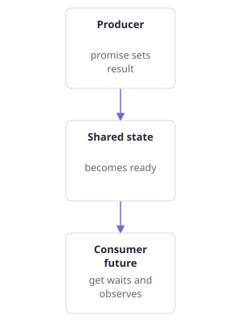

# Asynchronous results and task contracts

Transfer results, propagate exceptions, and distinguish scheduling from synchronization.

## Transfer one result through a shared state

Before this chapter: [Join before borrowed worker state is destroyed](../thread-coordination/README.md)

An asynchronous result separates producing an answer from asking for it. A promise supplies a value or exception to shared result state; a future observes that state. Deferred execution waits until the result is demanded rather than starting a worker immediately.

promise and future separate result production from consumption through a shared state. A promise normally makes that state ready once, while an ordinary future permits one retrieval through get. Readiness synchronization publishes the produced result; it does not automatically protect unrelated shared objects.



An ordinary future permits one get. An exception is transported through the same shared state. Result readiness does not provide a general lock for later mutations of unrelated shared objects.

Text description: Producer: promise sets result. Shared state: becomes ready. Consumer future: get waits and observes. Producer → Shared state (then); Shared state → Consumer future (then).

```cpp
#include <future>
#include <iostream>
#include <thread>

int main() {
  std::promise<int> promise;
  auto result = promise.get_future();
  std::jthread worker([p = std::move(promise)]() mutable { p.set_value(42); });
  std::cout << result.get();
}

```

Original program output:

```text
42
```

The promise moves into the worker and sets its result. get waits until the state is ready and consumes the future’s retrieval right.

Pitfall: Calling get twice on an ordinary future violates its valid-state precondition. Destroying an unsatisfied promise reports broken_promise to its consumer.

Question: Which statement correctly describes this example’s contract?

1. promise allows unlimited successful set_value calls
2. A future synchronizes every shared variable automatically
3. An ordinary future provides one get result

Answer: 3. An ordinary future provides one get result. The promise moves into the worker and sets its result. get waits until the state is ready and consumes the future’s retrieval right.

### Run the starter, then try a change

Open `native/examples/lib-future-promise.cpp` in your checkout. From the repository root, use this command in a Linux or Codespaces terminal to compile and run the current file in a fresh temporary directory.

```sh
run_dir=$(mktemp -d) && g++ -std=c++20 -Wall -Wextra -Werror native/examples/lib-future-promise.cpp -pthread -o "$run_dir/example" && (cd "$run_dir" && ./example)
```

Replace

```cpp
p.set_value(42)
```

With

```cpp
p.set_value(7)
```

Rerun the terminal command. Compare the result read by get. Which operation supplies that value to the future?

## Capture task exceptions in the result state

Before this chapter: [Join before borrowed worker state is destroyed](../thread-coordination/README.md)

packaged_task adapts a callable to a future-based result. It stores either the returned value or the thrown exception in a shared state. It is not itself a thread pool or scheduling policy: the caller still decides where and when the task runs.

```cpp
#include <future>
#include <iostream>
#include <stdexcept>

int main() {
  std::packaged_task<int()> task(
      []() -> int { throw std::runtime_error("task failed"); });
  auto result = task.get_future();
  task();
  try {
    std::cout << result.get();
  } catch (const std::runtime_error &e) {
    std::cout << e.what();
  }
}

```

Original program output:

```text
task failed
```

The callable executes synchronously in this fixture, but its exception is observed later by get rather than escaping from task invocation.

Pitfall: An exception captured by a task does not undo side effects performed before the throw. State mutation still needs a failure-preservation contract.

Question: Which statement correctly describes this example’s contract?

1. packaged_task always starts a background thread
2. Capturing an exception rolls back all side effects
3. packaged_task does not schedule itself

Answer: 3. packaged_task does not schedule itself. The callable executes synchronously in this fixture, but its exception is observed later by get rather than escaping from task invocation.

### Run the starter, then try a change

Open `native/examples/lib-packaged-task.cpp` in your checkout. From the repository root, use this command in a Linux or Codespaces terminal to compile and run the current file in a fresh temporary directory.

```sh
run_dir=$(mktemp -d) && g++ -std=c++20 -Wall -Wextra -Werror native/examples/lib-packaged-task.cpp -pthread -o "$run_dir/example" && (cd "$run_dir" && ./example)
```

Replace

```cpp
throw std::runtime_error("task failed");
```

With

```cpp
return 42;
```

Rerun the terminal command. Compare the exception message with the numeric result. In which run does future.get return normally?

## Select deferred execution explicitly

Before this chapter: [Join before borrowed worker state is destroyed](../thread-coordination/README.md)

async can use asynchronous or deferred execution depending on the selected launch policy. The default permits implementation choice; an explicit deferred task runs when a qualifying waiting operation requests its result. Captures must remain valid through that eventual execution.

```cpp
#include <future>
#include <iostream>

int main() {
  int calls = 0;
  auto result = std::async(std::launch::deferred, [&] {
    ++calls;
    return 9;
  });
  std::cout << calls << " ";
  auto value = result.get();
  std::cout << calls << " " << value;
}

```

Original program output:

```text
0 1 9
```

The counter is zero before get and one afterward because deferred execution occurs in the waiting thread.

Pitfall: A future from an asynchronously launched task may block on destruction. Dropping futures is not a general fire-and-forget scheduling mechanism.

Question: Which statement correctly describes this example’s contract?

1. Deferred execution occurs when the result is demanded
2. The default async policy guarantees a new thread
3. Discarding every async future guarantees nonblocking execution

Answer: 1. Deferred execution occurs when the result is demanded. The counter is zero before get and one afterward because deferred execution occurs in the waiting thread.

### Run the starter, then try a change

Open `native/examples/lib-async-policy.cpp` in your checkout. From the repository root, use this command in a Linux or Codespaces terminal to compile and run the current file in a fresh temporary directory.

```sh
run_dir=$(mktemp -d) && g++ -std=c++20 -Wall -Wextra -Werror native/examples/lib-async-policy.cpp -pthread -o "$run_dir/example" && (cd "$run_dir" && ./example)
```

Replace

```cpp
++calls;
```

With

```cpp
calls += 2;
```

Rerun the terminal command. Compare calls before and after get and the returned value. Does the deferred callable run before get?

## Share a ready result with multiple readers

Before this chapter: [Join before borrowed worker state is destroyed](../thread-coordination/README.md)

shared_future permits multiple consumers to observe one shared result state. Unlike future, repeated get is supported, and a value result is exposed by const reference. Sharing readiness does not make mutation of an object reachable through the result inherently thread-safe.

```cpp
#include <future>
#include <iostream>
#include <thread>

int main() {
  std::promise<int> promise;
  std::shared_future<int> result = promise.get_future().share();
  int a = 0, b = 0;
  std::jthread first([&] { a = result.get(); });
  std::jthread second([&] { b = result.get(); });
  promise.set_value(7);
  first.join();
  second.join();
  std::cout << a << " " << b;
}

```

Original program output:

```text
7 7
```

Two threads retrieve the same published integer. Each writes a separate local result, and joining both threads establishes safe observation before printing.

Pitfall: A reference obtained from get must not outlive the shared state that owns the value. Shared pointers contained in the result still need object-level synchronization.

Question: Which statement correctly describes this example’s contract?

1. Every get removes the result from the state
2. shared_future supports repeated observation of one state
3. A shared_future makes the pointed-to object safe to mutate concurrently

Answer: 2. shared_future supports repeated observation of one state. Two threads retrieve the same published integer. Each writes a separate local result, and joining both threads establishes safe observation before printing.

### Run the starter, then try a change

Open `native/examples/lib-shared-future.cpp` in your checkout. From the repository root, use this command in a Linux or Codespaces terminal to compile and run the current file in a fresh temporary directory.

```sh
run_dir=$(mktemp -d) && g++ -std=c++20 -Wall -Wextra -Werror native/examples/lib-shared-future.cpp -pthread -o "$run_dir/example" && (cd "$run_dir" && ./example)
```

Replace

```cpp
promise.set_value(7)
```

With

```cpp
promise.set_value(8)
```

Rerun the terminal command. Compare both printed values. Can each reader retrieve the same published result?

## Chapter project

Build an asynchronous batch interface with explicit launch, error, and shutdown policies.
