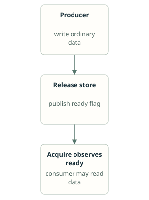

# Atomics and the memory model

Reason about atomic operations and happens-before relations.

## An atomic read-modify-write prevents lost counter increments

Before this chapter: [Acquire several mutexes with a consistent protocol](../thread-coordination/README.md)

A read-modify-write operation reads and changes an atomic value as one indivisible operation. A memory order specifies ordering and synchronization constraints for atomic accesses. The lessons must establish the particular ordering relation needed for ordinary shared data.

An atomic fetch_add combines observation and update into one indivisible operation on that atomic object. Two separate load/store calls are not equivalent to a read-modify-write and can lose concurrent increments.

This counter needs atomicity but does not publish other data, so relaxed ordering is sufficient for the increments themselves. Joins establish completion before the final observation.

```cpp
#include <atomic>
#include <iostream>
#include <thread>

int main() {
    std::atomic<unsigned> count{0};
    auto work = [&] {
        for (unsigned i = 0; i < 10000; ++i)
            count.fetch_add(1, std::memory_order_relaxed);
    };
    std::jthread first(work), second(work);
    first.join();
    second.join();
    std::cout << "count=" << count.load() << "\n";
}

```

Original program output:

```text
count=20000
```

Every fetch_add contributes one increment, producing exactly twenty thousand after both workers join.

Pitfall: An atomic load followed by an atomic store is still two operations and can overwrite another thread’s increment.

Question: What operation combines the update atomically?

1. load followed by store
2. fetch_add
3. A non-atomic ++ protected only by hope

Answer: 2. The read-modify-write is indivisible for this atomic object.

### Run the starter, then try a change

Open `native/examples/atomic-rmw.cpp` in your checkout. From the repository root, use this command in a Linux or Codespaces terminal to compile and run the current file in a fresh temporary directory.

```sh
run_dir=$(mktemp -d) && g++ -std=c++20 -Wall -Wextra -Werror native/examples/atomic-rmw.cpp -pthread -o "$run_dir/example" && (cd "$run_dir" && ./example)
```

Replace

```cpp
i < 10000
```

With

```cpp
i < 5000
```

Rerun the terminal command. Compare count=. How many increments do the two workers request altogether after changing the loop bound?

## A failed compare-exchange updates the expected value

Before this chapter: [Acquire several mutexes with a consistent protocol](../thread-coordination/README.md)

compare_exchange compares an atomic object with an expected value and conditionally publishes a desired value. On failure, it writes the observed value back into expected. This supports retry loops without an extra uncoordinated assumption.

Weak compare-exchange can also fail spuriously and is normally used in a loop. This fixture uses the strong operation for one deterministic mismatch.

```cpp
#include <atomic>
#include <iostream>

int main() {
    std::atomic<int> value{7};
    int expected = 5;
    bool changed = value.compare_exchange_strong(expected, 9);
    std::cout << "changed=" << changed << " expected=" << expected
              << " value=" << value.load() << "\n";
}

```

Original program output:

```text
changed=0 expected=7 value=7
```

The initial expected value does not match, so the atomic remains seven and expected becomes seven.

Pitfall: A retry loop that never accounts for the updated expected state can apply the wrong decision rule.

Question: What does expected contain after this failure?

1. The observed value seven
2. The desired value nine
3. Its original value five

Answer: 1. Failure reports the currently observed atomic value through expected.

### Run the starter, then try a change

Open `native/examples/compare-exchange.cpp` in your checkout. From the repository root, use this command in a Linux or Codespaces terminal to compile and run the current file in a fresh temporary directory.

```sh
run_dir=$(mktemp -d) && g++ -std=c++20 -Wall -Wextra -Werror native/examples/compare-exchange.cpp -pthread -o "$run_dir/example" && (cd "$run_dir" && ./example)
```

Replace

```cpp
int expected = 5;
```

With

```cpp
int expected = 7;
```

Rerun the terminal command. Compare changed=, expected= and value=. What gets replaced when the original atomic value matches the expectation?

## Publish a prepared batch before readers inspect it

Before this chapter: [Acquire several mutexes with a consistent protocol](../thread-coordination/README.md)

A release store can publish preceding initialization to a reader that observes it through an acquire load. The ordering relation applies to the protected prior writes; it does not permit future unsynchronized mutation of that same data.

Keep the published object alive through reader completion and make the single-publication limitation explicit.



The acquire must observe the matching release (or the applicable release sequence) to establish the depicted happens-before relation. Merely using an atomic flag or unrelated relaxed operations does not publish ordinary data safely.

Text description: Producer: write ordinary data. Release store: publish ready flag. Acquire observes ready: consumer may read data. Producer → Release store (then); Release store → Acquire observes ready (then).

```cpp
#include <array>
#include <atomic>
#include <iostream>
#include <thread>

int main() {
    std::array<int, 2> values{};
    std::atomic<bool> ready{false};
    int result = 0;
    std::jthread reader([&] {
        while (!ready.load(std::memory_order_acquire))
            std::this_thread::yield();
        result = values[0] + values[1];
    });
    values = {20, 22};
    ready.store(true, std::memory_order_release);
    reader.join();
    std::cout << "batch=" << result << "\n";
}

```

Original program output:

```text
batch=42
```

The reader observes the release and then reads the initialized pair. The writer performs no later mutation.

Pitfall: Changing the flag operations to relaxed removes this publication guarantee for the non-atomic array.

Question: What is made visible by observing the release?

1. The preceding array initialization
2. Every future mutation automatically
3. The compiler’s temporary files

Answer: 1. Acquire/release establishes visibility of the writes ordered before publication.

### Run the starter, then try a change

Open `native/examples/release-acquire-data.cpp` in your checkout. From the repository root, use this command in a Linux or Codespaces terminal to compile and run the current file in a fresh temporary directory.

```sh
run_dir=$(mktemp -d) && g++ -std=c++20 -Wall -Wextra -Werror native/examples/release-acquire-data.cpp -pthread -o "$run_dir/example" && (cd "$run_dir" && ./example)
```

Replace

```cpp
values = {20, 22}
```

With

```cpp
values = {20, 23}
```

Rerun the terminal command. Compare batch=. Which synchronization publishes the changed data before the reader sums it?

## Sequential consistency constrains the global atomic order

Before this chapter: [Acquire several mutexes with a consistent protocol](../thread-coordination/README.md)

Sequentially consistent atomic operations participate in a single total order compatible with each thread’s sequencing requirements. In the classic two-store/two-load fixture, both reads cannot observe zero under that model.

The exact observed pair is schedule-dependent, so the program checks an allowed-outcome property rather than asserting one arbitrary interleaving.

```cpp
#include <atomic>
#include <iostream>
#include <thread>

int main() {
    std::atomic<int> a{0}, b{0};
    int first = 0, second = 0;
    std::jthread one([&] {
        a.store(1);
        first = b.load();
    });
    std::jthread two([&] {
        b.store(1);
        second = a.load();
    });
    one.join();
    two.join();
    bool allowed = !(first == 0 && second == 0);
    std::cout << "allowed=" << allowed << "\n";
    return allowed ? 0 : 1;
}

```

Original program output:

```text
allowed=1
```

The check permits all outcomes consistent with the stated model and rejects the forbidden both-zero result.

Pitfall: Printing one observed schedule repeatedly does not prove that other permitted schedules cannot occur.

Question: Why does the output avoid one exact read pair?

1. Atomic loads return random values
2. The test ignores all results
3. Several schedules are permitted

Answer: 3. The contract constrains outcomes without fixing the scheduler.

### Run the starter, then try a change

Open `native/examples/sequential-consistency.cpp` in your checkout. From the repository root, use this command in a Linux or Codespaces terminal to compile and run the current file in a fresh temporary directory.

```sh
run_dir=$(mktemp -d) && g++ -std=c++20 -Wall -Wextra -Werror native/examples/sequential-consistency.cpp -pthread -o "$run_dir/example" && (cd "$run_dir" && ./example)
```

Replace

```cpp
std::cout << "allowed=" << allowed
```

With

```cpp
std::cout << "first=" << first << " second=" << second << " allowed=" << allowed
```

Rerun the terminal command. Compare both observed loads and allowed=. The two loads can vary between runs. Which pair does the sequentially consistent check reject?

## Publish an owning immutable snapshot handle

Before this chapter: [Acquire several mutexes with a consistent protocol](../thread-coordination/README.md)

New terms and notation:

A braced list such as {1, 2, 3} can supply starting values or a short sequence to visit. Its meaning depends on the destination or operation; it does not always construct a vector.

std::shared_ptr<T> lets multiple owners keep one managed object alive. Releasing the last owner destroys that object. Shared lifetime does not make reads and writes to the object automatically safe across threads.

C++20 supports atomic shared_ptr operations that combine publication with owning handle transfer. A reader holding an old shared owner can continue reading that immutable version after a newer one is published.

The pointed-to data must remain immutable through that read contract. Atomic handle access does not make arbitrary mutation of the pointee safe, and lock-free implementation is not guaranteed.

```cpp
#include <atomic>
#include <iostream>
#include <memory>
#include <vector>

int main() {
    using Snapshot = std::shared_ptr<const std::vector<int>>;
    std::atomic<Snapshot> current{
        std::make_shared<const std::vector<int>>(std::initializer_list<int>{1, 2})};
    auto old = current.load();
    current.store(
        std::make_shared<const std::vector<int>>(std::initializer_list<int>{3, 4}));
    std::cout << old->at(0) << " " << current.load()->at(0) << "\n";
}

```

Original program output:

```text
1 3
```

The retained old owner still sees its original vector while a new load obtains the replacement snapshot.

Pitfall: Atomic shared_ptr does not promise lock-free behavior on every implementation.

Question: Why is the old snapshot still alive?

1. The atomic permanently keeps every version
2. Its vector capacity is small
3. The reader retains a shared owner

Answer: 3. Ownership, not just publication ordering, protects its lifetime.

### Run the starter, then try a change

Open `native/examples/atomic-snapshot-owner.cpp` in your checkout. From the repository root, use this command in a Linux or Codespaces terminal to compile and run the current file in a fresh temporary directory.

```sh
run_dir=$(mktemp -d) && g++ -std=c++20 -Wall -Wextra -Werror native/examples/atomic-snapshot-owner.cpp -pthread -o "$run_dir/example" && (cd "$run_dir" && ./example)
```

Replace

```cpp
{3, 4}
```

With

```cpp
{5, 6}
```

Rerun the terminal command. Compare the old and current first elements. Does publishing a replacement mutate the snapshot the reader already owns?

## Chapter project

Explain each edge in a single-publication protocol.
