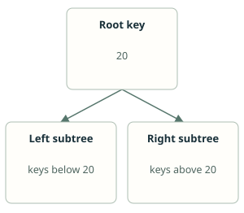

# Search trees and balancing

Preserve ordering, ownership, and height through updates.

## Preserve the search-tree ordering invariant

Before this chapter: [Check a hash implementation against an independent model](../hashing/README.md)

A search tree organizes keys around a root and child subtrees. A subtree contains a node and its descendants. Height measures path length down the tree; a rotation changes links while preserving sorted key order.

A binary search tree partitions keys around each node: smaller keys go left and larger keys go right. Ownership follows child links while searches borrow nodes. In-order traversal should therefore produce unique sorted keys.

The shared implementation is an AVL tree; the following lessons examine how rotations preserve this ordering while controlling height.



This schematic assumes unique keys. Every descendant, not just each immediate child, must satisfy its ancestor bounds. Balance and ownership are additional invariants, not consequences of ordering.

Text description: Root key: 20. Left subtree: keys below 20. Right subtree: keys above 20. Root key → Left subtree (less); Root key → Right subtree (greater).

```cpp
#include <algorithm>
#include <cmath>
#include <iostream>
#include <memory>
#include <utility>
#include <vector>

struct Node {
    int key, height = 1;
    std::unique_ptr<Node> left, right;
    explicit Node(int value) : key(value) {
    }
};
using Tree = std::unique_ptr<Node>;
int height(const Tree &node) {
    return node ? node->height : 0;
}
void update(Node &node) {
    node.height = 1 + std::max(height(node.left), height(node.right));
}
Tree left_rotate(Tree root) {
    auto raised = std::move(root->right);
    root->right = std::move(raised->left);
    update(*root);
    raised->left = std::move(root);
    update(*raised);
    return raised;
}
Tree right_rotate(Tree root) {
    auto raised = std::move(root->left);
    root->left = std::move(raised->right);
    update(*root);
    raised->right = std::move(root);
    update(*raised);
    return raised;
}
void balance(Tree &root) {
    if (!root)
        return;
    update(*root);
    if (height(root->left) - height(root->right) > 1) {
        if (height(root->left->right) > height(root->left->left))
            root->left = left_rotate(std::move(root->left));
        root = right_rotate(std::move(root));
    } else if (height(root->right) - height(root->left) > 1) {
        if (height(root->right->left) > height(root->right->right))
            root->right = right_rotate(std::move(root->right));
        root = left_rotate(std::move(root));
    }
}
void insert(Tree &root, int key) {
    if (!root) {
        root = std::make_unique<Node>(key);
        return;
    }
    if (key < root->key)
        insert(root->left, key);
    else if (key > root->key)
        insert(root->right, key);
    balance(root);
}
bool contains(const Tree &root, int key) {
    const Node *node = root.get();
    while (node) {
        if (key == node->key)
            return true;
        node = key < node->key ? node->left.get() : node->right.get();
    }
    return false;
}
void erase(Tree &root, int key) {
    if (!root)
        return;
    if (key < root->key)
        erase(root->left, key);
    else if (key > root->key)
        erase(root->right, key);
    else if (!root->left) {
        auto next = std::move(root->right);
        root = std::move(next);
    } else if (!root->right) {
        auto next = std::move(root->left);
        root = std::move(next);
    } else {
        const Node *next = root->right.get();
        while (next->left)
            next = next->left.get();
        root->key = next->key;
        erase(root->right, next->key);
    }
    balance(root);
}
void ordered(const Tree &root, std::vector<int> &result) {
    if (!root)
        return;
    ordered(root->left, result);
    result.push_back(root->key);
    ordered(root->right, result);
}
bool heights_valid(const Tree &root) {
    return !root ||
           (root->height == 1 + std::max(height(root->left), height(root->right)) &&
            std::abs(height(root->left) - height(root->right)) <= 1 &&
            heights_valid(root->left) && heights_valid(root->right));
}

int main() {
    Tree root;
    for (int key : {4, 2, 6, 1, 3})
        insert(root, key);
    std::vector<int> values;
    ordered(root, values);
    for (int key : values)
        std::cout << key;
    std::cout << " found=" << contains(root, 3) << "\n";
}

```

Original program output:

```text
12346 found=1
```

Traversal visits left subtree, node, then right subtree. Lookup follows the same ordering rather than scanning the complete tree.

Pitfall: A balanced shape alone does not prove key ordering or reachability.

Question: Which traversal exposes sorted key order?

1. In-order traversal
2. Root-only traversal
3. Following only right children

Answer: 1. The ordering invariant places each node between its left and right descendants.

### Run the starter, then try a change

Open `native/examples/tree-ordering.cpp` in your checkout. From the repository root, use this command in a Linux or Codespaces terminal to compile and run the current file in a fresh temporary directory.

```sh
run_dir=$(mktemp -d) && g++ -std=c++20 -Wall -Wextra -Werror native/examples/tree-ordering.cpp -o "$run_dir/example" && (cd "$run_dir" && ./example)
```

Replace

```cpp
{4, 2, 6, 1, 3}
```

With

```cpp
{4, 2, 6, 1, 3, 3}
```

Rerun the terminal command. Compare the ordered values and found=. Does inserting an existing key add a second node?

## Keep stored heights consistent with structure

Before this chapter: [Check a hash implementation against an independent model](../hashing/README.md)

AVL balancing requires each node’s child heights to differ by at most one. Stored heights must also equal one plus the maximum child height. A stale height can make a later balancing decision wrong even when current output appears sorted.

The empty subtree has height zero in this implementation, so a leaf has height one.

```cpp
#include <algorithm>
#include <cmath>
#include <iostream>
#include <memory>
#include <utility>
#include <vector>

struct Node {
    int key, height = 1;
    std::unique_ptr<Node> left, right;
    explicit Node(int value) : key(value) {
    }
};
using Tree = std::unique_ptr<Node>;
int height(const Tree &node) {
    return node ? node->height : 0;
}
void update(Node &node) {
    node.height = 1 + std::max(height(node.left), height(node.right));
}
Tree left_rotate(Tree root) {
    auto raised = std::move(root->right);
    root->right = std::move(raised->left);
    update(*root);
    raised->left = std::move(root);
    update(*raised);
    return raised;
}
Tree right_rotate(Tree root) {
    auto raised = std::move(root->left);
    root->left = std::move(raised->right);
    update(*root);
    raised->right = std::move(root);
    update(*raised);
    return raised;
}
void balance(Tree &root) {
    if (!root)
        return;
    update(*root);
    if (height(root->left) - height(root->right) > 1) {
        if (height(root->left->right) > height(root->left->left))
            root->left = left_rotate(std::move(root->left));
        root = right_rotate(std::move(root));
    } else if (height(root->right) - height(root->left) > 1) {
        if (height(root->right->left) > height(root->right->right))
            root->right = right_rotate(std::move(root->right));
        root = left_rotate(std::move(root));
    }
}
void insert(Tree &root, int key) {
    if (!root) {
        root = std::make_unique<Node>(key);
        return;
    }
    if (key < root->key)
        insert(root->left, key);
    else if (key > root->key)
        insert(root->right, key);
    balance(root);
}
bool contains(const Tree &root, int key) {
    const Node *node = root.get();
    while (node) {
        if (key == node->key)
            return true;
        node = key < node->key ? node->left.get() : node->right.get();
    }
    return false;
}
void erase(Tree &root, int key) {
    if (!root)
        return;
    if (key < root->key)
        erase(root->left, key);
    else if (key > root->key)
        erase(root->right, key);
    else if (!root->left) {
        auto next = std::move(root->right);
        root = std::move(next);
    } else if (!root->right) {
        auto next = std::move(root->left);
        root = std::move(next);
    } else {
        const Node *next = root->right.get();
        while (next->left)
            next = next->left.get();
        root->key = next->key;
        erase(root->right, next->key);
    }
    balance(root);
}
void ordered(const Tree &root, std::vector<int> &result) {
    if (!root)
        return;
    ordered(root->left, result);
    result.push_back(root->key);
    ordered(root->right, result);
}
bool heights_valid(const Tree &root) {
    return !root ||
           (root->height == 1 + std::max(height(root->left), height(root->right)) &&
            std::abs(height(root->left) - height(root->right)) <= 1 &&
            heights_valid(root->left) && heights_valid(root->right));
}

int main() {
    Tree root;
    for (int key : {1, 2, 3, 4, 5, 6, 7})
        insert(root, key);
    std::cout << "root=" << root->key << " height=" << height(root)
              << " valid=" << heights_valid(root) << "\n";
}

```

Original program output:

```text
root=4 height=3 valid=1
```

Increasing insertions trigger rotations; the final seven-key tree has root four and height three.

Pitfall: Checking only sorted traversal can miss incorrect stored heights that break future updates.

Question: What height does an empty subtree have here?

1. One
2. The parent height
3. Zero

Answer: 3. The height convention makes leaf height one.

### Run the starter, then try a change

Open `native/examples/avl-height.cpp` in your checkout. From the repository root, use this command in a Linux or Codespaces terminal to compile and run the current file in a fresh temporary directory.

```sh
run_dir=$(mktemp -d) && g++ -std=c++20 -Wall -Wextra -Werror native/examples/avl-height.cpp -o "$run_dir/example" && (cd "$run_dir" && ./example)
```

Replace

```cpp
{1, 2, 3, 4, 5, 6, 7}
```

With

```cpp
{7, 6, 5, 4, 3, 2, 1}
```

Rerun the terminal command. Compare root=, height= and valid=. What does the height check establish after inserting the same keys in reverse?

## A rotation transfers ownership while preserving order

Before this chapter: [Check a hash implementation against an independent model](../hashing/README.md)

A single rotation raises a child and moves the child’s inner subtree to the old root. The sorted in-order sequence stays unchanged while the height imbalance is reduced.

unique_ptr moves make each structural ownership transfer explicit. Rotations do not allocate new nodes or copy owned subtrees.

```cpp
#include <algorithm>
#include <cmath>
#include <iostream>
#include <memory>
#include <utility>
#include <vector>

struct Node {
    int key, height = 1;
    std::unique_ptr<Node> left, right;
    explicit Node(int value) : key(value) {
    }
};
using Tree = std::unique_ptr<Node>;
int height(const Tree &node) {
    return node ? node->height : 0;
}
void update(Node &node) {
    node.height = 1 + std::max(height(node.left), height(node.right));
}
Tree left_rotate(Tree root) {
    auto raised = std::move(root->right);
    root->right = std::move(raised->left);
    update(*root);
    raised->left = std::move(root);
    update(*raised);
    return raised;
}
Tree right_rotate(Tree root) {
    auto raised = std::move(root->left);
    root->left = std::move(raised->right);
    update(*root);
    raised->right = std::move(root);
    update(*raised);
    return raised;
}
void balance(Tree &root) {
    if (!root)
        return;
    update(*root);
    if (height(root->left) - height(root->right) > 1) {
        if (height(root->left->right) > height(root->left->left))
            root->left = left_rotate(std::move(root->left));
        root = right_rotate(std::move(root));
    } else if (height(root->right) - height(root->left) > 1) {
        if (height(root->right->left) > height(root->right->right))
            root->right = right_rotate(std::move(root->right));
        root = left_rotate(std::move(root));
    }
}
void insert(Tree &root, int key) {
    if (!root) {
        root = std::make_unique<Node>(key);
        return;
    }
    if (key < root->key)
        insert(root->left, key);
    else if (key > root->key)
        insert(root->right, key);
    balance(root);
}
bool contains(const Tree &root, int key) {
    const Node *node = root.get();
    while (node) {
        if (key == node->key)
            return true;
        node = key < node->key ? node->left.get() : node->right.get();
    }
    return false;
}
void erase(Tree &root, int key) {
    if (!root)
        return;
    if (key < root->key)
        erase(root->left, key);
    else if (key > root->key)
        erase(root->right, key);
    else if (!root->left) {
        auto next = std::move(root->right);
        root = std::move(next);
    } else if (!root->right) {
        auto next = std::move(root->left);
        root = std::move(next);
    } else {
        const Node *next = root->right.get();
        while (next->left)
            next = next->left.get();
        root->key = next->key;
        erase(root->right, next->key);
    }
    balance(root);
}
void ordered(const Tree &root, std::vector<int> &result) {
    if (!root)
        return;
    ordered(root->left, result);
    result.push_back(root->key);
    ordered(root->right, result);
}
bool heights_valid(const Tree &root) {
    return !root ||
           (root->height == 1 + std::max(height(root->left), height(root->right)) &&
            std::abs(height(root->left) - height(root->right)) <= 1 &&
            heights_valid(root->left) && heights_valid(root->right));
}

int main() {
    Tree ascending, descending;
    for (int key : {10, 20, 30})
        insert(ascending, key);
    for (int key : {30, 20, 10})
        insert(descending, key);
    std::cout << ascending->key << " " << descending->key << "\n";
}

```

Original program output:

```text
20 20
```

Opposite skew directions require opposite rotations. Both produce the middle key as root.

Pitfall: Forgetting to reconnect the inner subtree can leak reachability or lose keys even if the new root looks correct.

Question: Do rotations need new node allocations here?

1. No
2. Yes, one per key
3. Only for a right rotation

Answer: 1. They transfer existing owning links.

### Run the starter, then try a change

Open `native/examples/avl-single-rotation.cpp` in your checkout. From the repository root, use this command in a Linux or Codespaces terminal to compile and run the current file in a fresh temporary directory.

```sh
run_dir=$(mktemp -d) && g++ -std=c++20 -Wall -Wextra -Werror native/examples/avl-single-rotation.cpp -o "$run_dir/example" && (cd "$run_dir" && ./example)
```

Replace

```cpp
{10, 20, 30}
```

With

```cpp
{10, 20, 40}
```

Rerun the terminal command. Compare the ascending and descending roots. Which key does the ascending insertion promote after rotation?

## Resolve a zigzag imbalance in two steps

Before this chapter: [Check a hash implementation against an independent model](../hashing/README.md)

A left-right or right-left insertion creates an inner-heavy child. First rotate that child into an outer-heavy shape, then rotate the parent. Both updates must recompute affected heights in dependency order.

Treat the two rotations as structural operations with the same ordering invariant rather than as a special-case key swap.

```cpp
#include <algorithm>
#include <cmath>
#include <iostream>
#include <memory>
#include <utility>
#include <vector>

struct Node {
    int key, height = 1;
    std::unique_ptr<Node> left, right;
    explicit Node(int value) : key(value) {
    }
};
using Tree = std::unique_ptr<Node>;
int height(const Tree &node) {
    return node ? node->height : 0;
}
void update(Node &node) {
    node.height = 1 + std::max(height(node.left), height(node.right));
}
Tree left_rotate(Tree root) {
    auto raised = std::move(root->right);
    root->right = std::move(raised->left);
    update(*root);
    raised->left = std::move(root);
    update(*raised);
    return raised;
}
Tree right_rotate(Tree root) {
    auto raised = std::move(root->left);
    root->left = std::move(raised->right);
    update(*root);
    raised->right = std::move(root);
    update(*raised);
    return raised;
}
void balance(Tree &root) {
    if (!root)
        return;
    update(*root);
    if (height(root->left) - height(root->right) > 1) {
        if (height(root->left->right) > height(root->left->left))
            root->left = left_rotate(std::move(root->left));
        root = right_rotate(std::move(root));
    } else if (height(root->right) - height(root->left) > 1) {
        if (height(root->right->left) > height(root->right->right))
            root->right = right_rotate(std::move(root->right));
        root = left_rotate(std::move(root));
    }
}
void insert(Tree &root, int key) {
    if (!root) {
        root = std::make_unique<Node>(key);
        return;
    }
    if (key < root->key)
        insert(root->left, key);
    else if (key > root->key)
        insert(root->right, key);
    balance(root);
}
bool contains(const Tree &root, int key) {
    const Node *node = root.get();
    while (node) {
        if (key == node->key)
            return true;
        node = key < node->key ? node->left.get() : node->right.get();
    }
    return false;
}
void erase(Tree &root, int key) {
    if (!root)
        return;
    if (key < root->key)
        erase(root->left, key);
    else if (key > root->key)
        erase(root->right, key);
    else if (!root->left) {
        auto next = std::move(root->right);
        root = std::move(next);
    } else if (!root->right) {
        auto next = std::move(root->left);
        root = std::move(next);
    } else {
        const Node *next = root->right.get();
        while (next->left)
            next = next->left.get();
        root->key = next->key;
        erase(root->right, next->key);
    }
    balance(root);
}
void ordered(const Tree &root, std::vector<int> &result) {
    if (!root)
        return;
    ordered(root->left, result);
    result.push_back(root->key);
    ordered(root->right, result);
}
bool heights_valid(const Tree &root) {
    return !root ||
           (root->height == 1 + std::max(height(root->left), height(root->right)) &&
            std::abs(height(root->left) - height(root->right)) <= 1 &&
            heights_valid(root->left) && heights_valid(root->right));
}

int main() {
    Tree root;
    for (int key : {30, 10, 20})
        insert(root, key);
    std::cout << root->key << " left=" << root->left->key
              << " right=" << root->right->key << " valid=" << heights_valid(root)
              << "\n";
}

```

Original program output:

```text
20 left=10 right=30 valid=1
```

The middle key becomes root after a child rotation and a parent rotation, with both side subtrees retained.

Pitfall: Swapping only key values does not generally repair subtree ownership or balancing.

Question: Why rotate the child first?

1. To allocate a new root
2. To remove the smallest key
3. To convert the zigzag into a case a parent rotation can repair

Answer: 3. The first rotation changes the structural orientation of the heavy path.

### Run the starter, then try a change

Open `native/examples/avl-double-rotation.cpp` in your checkout. From the repository root, use this command in a Linux or Codespaces terminal to compile and run the current file in a fresh temporary directory.

```sh
run_dir=$(mktemp -d) && g++ -std=c++20 -Wall -Wextra -Werror native/examples/avl-double-rotation.cpp -o "$run_dir/example" && (cd "$run_dir" && ./example)
```

Replace

```cpp
{30, 10, 20}
```

With

```cpp
{10, 30, 20}
```

Rerun the terminal command. Compare the root, left=, right= and valid=. Does the mirrored case produce the same ordering and valid heights?

## Deletion can require rebalancing toward the root

Before this chapter: [Check a hash implementation against an independent model](../hashing/README.md)

Deleting a key can reduce a subtree’s height and create imbalances above the removed node. A two-child deletion replaces the key with an in-order successor and then removes that successor from its old location.

Validate both the set of keys and the height/balance invariants. Either check alone can miss a different class of structural bug.

```cpp
#include <algorithm>
#include <cmath>
#include <iostream>
#include <memory>
#include <utility>
#include <vector>

struct Node {
    int key, height = 1;
    std::unique_ptr<Node> left, right;
    explicit Node(int value) : key(value) {
    }
};
using Tree = std::unique_ptr<Node>;
int height(const Tree &node) {
    return node ? node->height : 0;
}
void update(Node &node) {
    node.height = 1 + std::max(height(node.left), height(node.right));
}
Tree left_rotate(Tree root) {
    auto raised = std::move(root->right);
    root->right = std::move(raised->left);
    update(*root);
    raised->left = std::move(root);
    update(*raised);
    return raised;
}
Tree right_rotate(Tree root) {
    auto raised = std::move(root->left);
    root->left = std::move(raised->right);
    update(*root);
    raised->right = std::move(root);
    update(*raised);
    return raised;
}
void balance(Tree &root) {
    if (!root)
        return;
    update(*root);
    if (height(root->left) - height(root->right) > 1) {
        if (height(root->left->right) > height(root->left->left))
            root->left = left_rotate(std::move(root->left));
        root = right_rotate(std::move(root));
    } else if (height(root->right) - height(root->left) > 1) {
        if (height(root->right->left) > height(root->right->right))
            root->right = right_rotate(std::move(root->right));
        root = left_rotate(std::move(root));
    }
}
void insert(Tree &root, int key) {
    if (!root) {
        root = std::make_unique<Node>(key);
        return;
    }
    if (key < root->key)
        insert(root->left, key);
    else if (key > root->key)
        insert(root->right, key);
    balance(root);
}
bool contains(const Tree &root, int key) {
    const Node *node = root.get();
    while (node) {
        if (key == node->key)
            return true;
        node = key < node->key ? node->left.get() : node->right.get();
    }
    return false;
}
void erase(Tree &root, int key) {
    if (!root)
        return;
    if (key < root->key)
        erase(root->left, key);
    else if (key > root->key)
        erase(root->right, key);
    else if (!root->left) {
        auto next = std::move(root->right);
        root = std::move(next);
    } else if (!root->right) {
        auto next = std::move(root->left);
        root = std::move(next);
    } else {
        const Node *next = root->right.get();
        while (next->left)
            next = next->left.get();
        root->key = next->key;
        erase(root->right, next->key);
    }
    balance(root);
}
void ordered(const Tree &root, std::vector<int> &result) {
    if (!root)
        return;
    ordered(root->left, result);
    result.push_back(root->key);
    ordered(root->right, result);
}
bool heights_valid(const Tree &root) {
    return !root ||
           (root->height == 1 + std::max(height(root->left), height(root->right)) &&
            std::abs(height(root->left) - height(root->right)) <= 1 &&
            heights_valid(root->left) && heights_valid(root->right));
}

int main() {
    Tree root;
    for (int key : {4, 2, 6, 1, 3, 5, 7})
        insert(root, key);
    erase(root, 4);
    erase(root, 1);
    std::vector<int> actual;
    ordered(root, actual);
    const std::vector<int> expected{2, 3, 5, 6, 7};
    bool valid = actual == expected && heights_valid(root);
    std::cout << "delete verified=" << valid << "\n";
    return valid ? 0 : 1;
}

```

Original program output:

```text
delete verified=1
```

The root-key and leaf deletions retain exactly the expected surviving keys and valid AVL heights.

Pitfall: Deletion must not leave an observer pointing to a removed node or skip rebalancing an ancestor.

Question: Which checks are both needed?

1. Only the root key
2. Only the number of allocations
3. Key contents and structural invariants

Answer: 3. Correct ordering, membership, heights, and ownership are separate properties.

### Run the starter, then try a change

Open `native/examples/avl-delete-oracle.cpp` in your checkout. From the repository root, use this command in a Linux or Codespaces terminal to compile and run the current file in a fresh temporary directory.

```sh
run_dir=$(mktemp -d) && g++ -std=c++20 -Wall -Wextra -Werror native/examples/avl-delete-oracle.cpp -o "$run_dir/example" && (cd "$run_dir" && ./example)
```

Replace

```cpp
erase(root, 4);
    erase(root, 1);
```

With

```cpp
erase(root, 1);
    erase(root, 4);
```

Rerun the terminal command. Compare delete verified=. Does reversing the deletion order change the expected set or the requirement to maintain valid heights?

## Chapter project

Validate a small AVL implementation after every operation.
