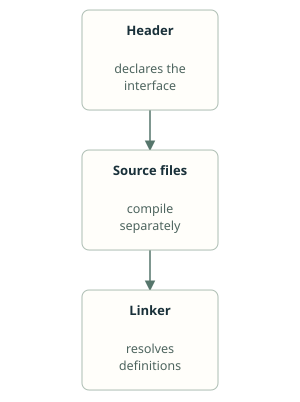

# Functions and program boundaries

Design value-based interfaces and understand translation units.

## A value parameter gives independent state

Before this chapter: [Name a calculation with a function](../values/README.md)

New terms and notation:

In C++, an object is a particular stored value with a type, such as one integer variable or one string. A type describes what kind of value it is; an object is one particular instance of that type.

A reference is another name for an existing object. In a declaration, T& gives access to that object rather than creating a separate T value; the referenced object must still exist when used.

const prevents changing a value through this particular name or access path. It does not say that every other part of the program is unable to change the same object.

The expression x += y combines y with the current value of x and stores the result back in x. For the integers here it adds numbers; for a string it appends text. This operation changes x rather than merely producing a separate result.

A declaration states what a function can be called with; a definition supplies its instructions. Compilation checks a source file, while linking connects compiled files. An interface is the part callers use; an implementation is how that interface’s work is done.

Passing by value constructs a function-local value from the argument. Changes to that parameter do not change the caller’s object. This is often the simplest ownership contract for a small value or for an operation that needs its own mutable copy.

A copy can have a real cost for a large collection. Choose the ownership behavior first, then consider whether moving or borrowing better fits the interface.

```cpp
#include <iostream>
#include <string>

std::string decorate(std::string value) {
    value += "!";
    return value;
}

int main() {
    std::string original = "Ada";
    std::cout << decorate(original) << "\n";
    std::cout << original << "\n";
}

```

Expected output:

```text
Ada!
Ada
```

decorate changes its local string and returns an owning result. The caller’s original string remains Ada.

Pitfall: Changing a parameter to a non-const reference changes the public mutation contract, even if the function name stays the same.

Question: Why is original unchanged?

1. The parameter is a separate string value
2. All function arguments are const
3. Returning undoes mutation

Answer: 1. The caller and parameter own distinct string objects.

Experiment: Compare value, const-reference, and mutable-reference signatures. State which versions can implement this operation without changing the caller.

## Return related results together

Before this chapter: [Name a calculation with a function](../values/README.md)

New terms and notation:

An exception is a way to report a failure that leaves the current calculation. throw starts that report; a matching catch in a try/catch statement handles it. Without a matching handler, the program can terminate instead of producing a normal result.

auto asks the compiler to determine a variable’s type from the value used to initialize it. The variable still has one fixed type; it does not change type as the program runs.

struct defines a new type with named pieces of data called members. An object of that type holds its own member values, and the dot notation object.member accesses one of them.

A structured binding gives separate local names to pieces of one returned value: auto [a, b] = result; names its two components. Whether these are copies or references depends on the declaration.

at(i) asks a container for the element at index i and reports an out-of-range index by throwing an exception. front() and back() instead access the first and last elements and require the container not to be empty.

A function with several related outputs can return a small value type. This avoids output parameters whose initialization and failure behavior are unclear. Structured bindings give names to the returned components.

The result should express meaning rather than merely position. Named members also help callers that do not use structured bindings.

```cpp
#include <iostream>
#include <vector>

struct Bounds {
    int minimum;
    int maximum;
};
Bounds bounds(const std::vector<int> &values) {
    int low = values.at(0), high = low;
    for (int value : values) {
        if (value < low)
            low = value;
        if (value > high)
            high = value;
    }
    return {low, high};
}

int main() {
    auto [minimum, maximum] = bounds({4, 2, 9});
    std::cout << minimum << " " << maximum << "\n";
}

```

Expected output:

```text
2 9
```

Both fields are computed before the result is returned. This version requires nonempty input and at(0) reports a violation by throwing.

Pitfall: A function that needs a nonempty range must document that contract or represent the empty outcome explicitly.

Question: How should an empty input be represented in a nonthrowing redesign?

1. An optional Bounds result
2. Two uninitialized integers
3. A reference to a local Bounds

Answer: 1. optional can distinguish absence from valid minimum and maximum values.

Experiment: Change the return type to optional<Bounds> and test empty, single-element, and repeated-element inputs.

## Overloads select from the static argument types

Before this chapter: [Name a calculation with a function](../values/README.md)

New terms and notation:

Overloads are functions with the same name but different parameter lists. The compiler chooses which one to call from the argument types and available conversions, not from the output you want.

An overload set provides several functions with one name and different parameter lists. Resolution chooses a viable best match from the argument types and conversions at the call site.

Do not use overloads whose meaning changes unexpectedly after an innocent numeric conversion. Small examples can make an interface’s selection rules observable.

```cpp
#include <iostream>

void show(int) {
    std::cout << "integer\n";
}
void show(double) {
    std::cout << "floating\n";
}

int main() {
    show(7);
    show(7.5);
}

```

Expected output:

```text
integer
floating
```

The integer literal selects the int overload. The floating literal has type double and selects the double overload.

Pitfall: The value stored in a double does not make it an int for overload resolution, even when it is mathematically integral.

Question: Which overload receives 7.0?

1. The double overload
2. The int overload
3. Whichever function is declared first

Answer: 1. The literal’s static type is double.

Experiment: Call show with a float and with a short. Explain the promotion that makes each overload a better match.

## A declaration states an interface before its definition

Before this chapter: [Name a calculation with a function](../values/README.md)

New terms and notation:

A translation unit is one source file after its included headers have been processed. The compiler checks and translates these units separately; the linker later connects references to definitions in other units.

A declaration lets a caller use a function before the implementation appears. In a multi-file program, declarations normally live in headers and definitions live in source files. Each source file is compiled into a translation unit before the linker resolves external symbols.

The browser editor uses one source file, but declaration and definition rules still apply.



A header makes declarations visible during compilation. The linker connects separately compiled definitions; a declaration alone does not supply an implementation.

Text description: Header: declares the interface. Source files: compile separately. Linker: resolves definitions. Header → Source files (then); Source files → Linker (then).

```cpp
#include <iostream>

int square(int value);
int square(int value) {
    return value * value;
}

int main() {
    std::cout << square(6) << "\n";
}

```

Expected output:

```text
36
```

The declaration and definition agree on the parameter and return types. The caller sees one function, not two overloads.

Pitfall: Declaring a function without providing a needed definition can compile successfully and then fail at link time.

Question: Which stage resolves a separately compiled function definition?

1. Lexing
2. The first call at runtime
3. Linking

Answer: 3. The linker connects references to external definitions.

Experiment: Move the declaration to a header and the definition to a second native source file. Build both files, then omit the implementation and inspect the link error.

## Headers must tolerate repeated inclusion

Before this chapter: [Name a calculation with a function](../values/README.md)

New terms and notation:

A header guard uses preprocessor instructions to include a header’s contents at most once in a translation unit. #ifndef tests whether a marker is absent, #define records it, and #endif ends the conditional region.

A header can be reached through several include paths in one translation unit. An include guard prevents its declarations from being processed repeatedly. Functions defined in headers also need appropriate linkage, commonly inline, to avoid duplicate definitions across translation units.

The inline keyword permits certain repeated definitions; it does not promise that the optimizer substitutes every call.

```cpp
#include <iostream>

#ifndef CPP_FOUNDRY_SCORE_HPP
#define CPP_FOUNDRY_SCORE_HPP
inline int clamp_score(int value) {
    return value < 0 ? 0 : value > 100 ? 100 : value;
}
#endif

int main() {
    std::cout << clamp_score(120) << "\n";
}

```

Expected output:

```text
100
```

The guarded block behaves like a small header. clamp_score has the same contract in every translation unit that includes it.

Pitfall: A guard prevents repetition inside one translation unit; it does not solve every cross-file definition problem.

Question: Does inline guarantee machine-code inlining?

1. No
2. Yes, for all calls
3. Only when a header guard exists

Answer: 1. inline has language linkage/definition rules independent of optimizer decisions.

Experiment: Create two source files including this header. Link them together and explain why the inline definition is permitted.

## Chapter project

Split a checked calculator into declarations, implementation, and a test caller.
