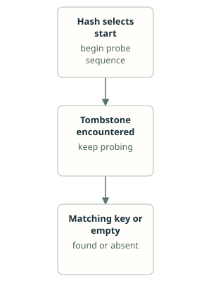

# Hash tables and collisions

Implement bucket selection, probing, deletion, and resizing.

## A hash chooses a bucket, not a unique identity

Before this chapter: [A queue preserves arrival order](../lists-queues/README.md)

A collision occurs when different keys select the same hash bucket or starting slot. Probing visits candidate slots in a defined order. A tombstone records a deleted slot without incorrectly ending searches that must pass through it.

Different keys can map to the same bucket. A correct hash table must resolve collisions and still compare the full key. This teaching table uses key modulo capacity so collision fixtures are explicit and portable.

The remainder function is not presented as a production-quality general-purpose hash. Its role is to expose the collision protocol.

```cpp
#include <array>
#include <iostream>
#include <optional>

template <std::size_t N> struct Hash {
    enum class State { empty, full, deleted };
    struct Slot {
        State state = State::empty;
        unsigned key = 0;
        int value = 0;
    };
    std::array<Slot, N> slots{};
    bool put(unsigned key, int value) {
        std::optional<std::size_t> free;
        for (std::size_t step = 0; step < N; ++step) {
            auto at = (key % N + step) % N;
            auto &slot = slots[at];
            if (slot.state == State::full && slot.key == key)
                return false;
            if (slot.state != State::full && !free)
                free = at;
            if (slot.state == State::empty)
                break;
        }
        if (!free)
            return false;
        slots[*free] = {State::full, key, value};
        return true;
    }
    std::optional<int> get(unsigned key) const {
        for (std::size_t step = 0; step < N; ++step) {
            const auto &slot = slots[(key % N + step) % N];
            if (slot.state == State::empty)
                return std::nullopt;
            if (slot.state == State::full && slot.key == key)
                return slot.value;
        }
        return std::nullopt;
    }
    bool erase(unsigned key) {
        for (std::size_t step = 0; step < N; ++step) {
            auto &slot = slots[(key % N + step) % N];
            if (slot.state == State::empty)
                return false;
            if (slot.state == State::full && slot.key == key) {
                slot.state = State::deleted;
                return true;
            }
        }
        return false;
    }
};

int main() {
    Hash<7> table;
    table.put(1, 10);
    table.put(8, 80);
    std::cout << "bucket=" << 1 % 7 << "," << 8 % 7 << " values=" << *table.get(1)
              << "," << *table.get(8) << "\n";
}

```

Original program output:

```text
bucket=1,1 values=10,80
```

Keys one and eight start in the same bucket but retain different payloads through probing and key comparison.

Pitfall: Treating equal hash values as equal keys loses distinct records.

Question: Do equal bucket numbers imply equal keys?

1. No
2. Yes
3. Only at low load

Answer: 1. Collisions are expected and require full-key comparison.

### Run the starter, then try a change

Open `native/examples/hash-buckets.cpp` in your checkout. From the repository root, use this command in a Linux or Codespaces terminal to compile and run the current file in a fresh temporary directory.

```sh
run_dir=$(mktemp -d) && g++ -std=c++20 -Wall -Wextra -Werror native/examples/hash-buckets.cpp -o "$run_dir/example" && (cd "$run_dir" && ./example)
```

Replace

```cpp
table.put(8, 80);
```

With

```cpp
table.put(8, 81);
```

Rerun the terminal command. Compare the two starting buckets and the two looked-up values. Which outputs show that keys with the same starting bucket stay distinct?

## Bound a probe sequence by the table capacity

Before this chapter: [A queue preserves arrival order](../lists-queues/README.md)

Linear probing checks successive slots with wraparound. A bounded table must stop after at most capacity inspections even when every slot has been occupied.

Insertion tracks a reusable slot but continues far enough to detect an existing duplicate key. A full-table rejection must leave the current mappings unchanged.

```cpp
#include <array>
#include <iostream>
#include <optional>

template <std::size_t N> struct Hash {
    enum class State { empty, full, deleted };
    struct Slot {
        State state = State::empty;
        unsigned key = 0;
        int value = 0;
    };
    std::array<Slot, N> slots{};
    bool put(unsigned key, int value) {
        std::optional<std::size_t> free;
        for (std::size_t step = 0; step < N; ++step) {
            auto at = (key % N + step) % N;
            auto &slot = slots[at];
            if (slot.state == State::full && slot.key == key)
                return false;
            if (slot.state != State::full && !free)
                free = at;
            if (slot.state == State::empty)
                break;
        }
        if (!free)
            return false;
        slots[*free] = {State::full, key, value};
        return true;
    }
    std::optional<int> get(unsigned key) const {
        for (std::size_t step = 0; step < N; ++step) {
            const auto &slot = slots[(key % N + step) % N];
            if (slot.state == State::empty)
                return std::nullopt;
            if (slot.state == State::full && slot.key == key)
                return slot.value;
        }
        return std::nullopt;
    }
    bool erase(unsigned key) {
        for (std::size_t step = 0; step < N; ++step) {
            auto &slot = slots[(key % N + step) % N];
            if (slot.state == State::empty)
                return false;
            if (slot.state == State::full && slot.key == key) {
                slot.state = State::deleted;
                return true;
            }
        }
        return false;
    }
};

int main() {
    Hash<3> table;
    table.put(0, 10);
    table.put(3, 30);
    table.put(6, 60);
    std::cout << "full=" << !table.put(9, 90) << " absent=" << !table.get(9) << "\n";
}

```

Original program output:

```text
full=1 absent=1
```

All three colliding slots are occupied. Both insertion and missing lookup terminate after a bounded probe sequence.

Pitfall: A probe loop that waits only for an empty slot can run forever when the table is full.

Question: What bounds unsuccessful probing?

1. The numeric value of the key
2. A required empty sentinel outside the array
3. At most N inspected slots

Answer: 3. The loop explicitly counts at most capacity probes.

### Run the starter, then try a change

Open `native/examples/linear-probing.cpp` in your checkout. From the repository root, use this command in a Linux or Codespaces terminal to compile and run the current file in a fresh temporary directory.

```sh
run_dir=$(mktemp -d) && g++ -std=c++20 -Wall -Wextra -Werror native/examples/linear-probing.cpp -o "$run_dir/example" && (cd "$run_dir" && ./example)
```

Replace

```cpp
table.put(6, 60);
```

With

```cpp
table.put(6, 60); table.erase(3);
```

Rerun the terminal command. Compare full= and absent= for key 9. What changes after removing an item from the full table?

## Deletion must preserve later probe paths

Before this chapter: [A queue preserves arrival order](../lists-queues/README.md)

A deleted slot cannot always be changed to never-used empty state. Other keys may have crossed it during insertion, so stopping there would hide live entries. A tombstone records reusable storage while allowing lookup to continue.

Tombstones affect performance and eventual rebuild policy, but they are first a correctness issue.



A tombstone preserves the search path after deletion. An unused empty slot can terminate an unsuccessful search; a bounded probe count is still needed when no empty slot remains.

Text description: Hash selects start: begin probe sequence. Tombstone encountered: keep probing. Matching key or empty: found or absent. Hash selects start → Tombstone encountered (then); Tombstone encountered → Matching key or empty (then).

```cpp
#include <array>
#include <iostream>
#include <optional>

template <std::size_t N> struct Hash {
    enum class State { empty, full, deleted };
    struct Slot {
        State state = State::empty;
        unsigned key = 0;
        int value = 0;
    };
    std::array<Slot, N> slots{};
    bool put(unsigned key, int value) {
        std::optional<std::size_t> free;
        for (std::size_t step = 0; step < N; ++step) {
            auto at = (key % N + step) % N;
            auto &slot = slots[at];
            if (slot.state == State::full && slot.key == key)
                return false;
            if (slot.state != State::full && !free)
                free = at;
            if (slot.state == State::empty)
                break;
        }
        if (!free)
            return false;
        slots[*free] = {State::full, key, value};
        return true;
    }
    std::optional<int> get(unsigned key) const {
        for (std::size_t step = 0; step < N; ++step) {
            const auto &slot = slots[(key % N + step) % N];
            if (slot.state == State::empty)
                return std::nullopt;
            if (slot.state == State::full && slot.key == key)
                return slot.value;
        }
        return std::nullopt;
    }
    bool erase(unsigned key) {
        for (std::size_t step = 0; step < N; ++step) {
            auto &slot = slots[(key % N + step) % N];
            if (slot.state == State::empty)
                return false;
            if (slot.state == State::full && slot.key == key) {
                slot.state = State::deleted;
                return true;
            }
        }
        return false;
    }
};

int main() {
    Hash<7> table;
    table.put(1, 10);
    table.put(8, 80);
    table.erase(1);
    std::cout << "deleted=" << !table.get(1) << " survivor=" << *table.get(8) << "\n";
}

```

Original program output:

```text
deleted=1 survivor=80
```

Lookup crosses the deleted first slot and still finds key eight farther along the probe path.

Pitfall: Marking the slot as never-used empty would incorrectly terminate the survivor lookup.

Question: Why does lookup cross a tombstone?

1. The tombstone still owns a row
2. A live collision may lie beyond it
3. Deleted keys compare equal to every key

Answer: 2. Deletion must retain the history needed by probing.

### Run the starter, then try a change

Open `native/examples/tombstones.cpp` in your checkout. From the repository root, use this command in a Linux or Codespaces terminal to compile and run the current file in a fresh temporary directory.

```sh
run_dir=$(mktemp -d) && g++ -std=c++20 -Wall -Wextra -Werror native/examples/tombstones.cpp -o "$run_dir/example" && (cd "$run_dir" && ./example)
```

Replace

```cpp
table.erase(1);
```

With

```cpp
table.erase(1); table.put(15, 150);
```

Rerun the terminal command. Compare deleted= and survivor=. Does a new colliding key stop the search from reaching the surviving key 8?

## Rebuild an index without changing its logical mappings

Before this chapter: [A queue preserves arrival order](../lists-queues/README.md)

Changing capacity changes bucket selection, so entries must be reinserted into a new table rather than copied to the same slot numbers. Build a candidate index and publish it only after all required mappings have been transferred.

This fixture uses two compile-time capacities to make the rebuild explicit. A dynamic implementation can own a resizable slot vector.

```cpp
#include <array>
#include <iostream>
#include <optional>

template <std::size_t N> struct Hash {
    enum class State { empty, full, deleted };
    struct Slot {
        State state = State::empty;
        unsigned key = 0;
        int value = 0;
    };
    std::array<Slot, N> slots{};
    bool put(unsigned key, int value) {
        std::optional<std::size_t> free;
        for (std::size_t step = 0; step < N; ++step) {
            auto at = (key % N + step) % N;
            auto &slot = slots[at];
            if (slot.state == State::full && slot.key == key)
                return false;
            if (slot.state != State::full && !free)
                free = at;
            if (slot.state == State::empty)
                break;
        }
        if (!free)
            return false;
        slots[*free] = {State::full, key, value};
        return true;
    }
    std::optional<int> get(unsigned key) const {
        for (std::size_t step = 0; step < N; ++step) {
            const auto &slot = slots[(key % N + step) % N];
            if (slot.state == State::empty)
                return std::nullopt;
            if (slot.state == State::full && slot.key == key)
                return slot.value;
        }
        return std::nullopt;
    }
    bool erase(unsigned key) {
        for (std::size_t step = 0; step < N; ++step) {
            auto &slot = slots[(key % N + step) % N];
            if (slot.state == State::empty)
                return false;
            if (slot.state == State::full && slot.key == key) {
                slot.state = State::deleted;
                return true;
            }
        }
        return false;
    }
};

int main() {
    Hash<3> old;
    old.put(1, 10);
    old.put(4, 40);
    Hash<7> candidate;
    for (const auto &slot : old.slots)
        if (slot.state == Hash<3>::State::full)
            candidate.put(slot.key, slot.value);
    std::cout << *candidate.get(1) << " " << *candidate.get(4) << "\n";
}

```

Original program output:

```text
10 40
```

The logical key/value pairs survive despite different bucket and probe positions in the new capacity.

Pitfall: Copying raw slots into a differently sized table breaks the new table’s lookup assumptions.

Question: What must remain invariant across rehashing?

1. Every physical slot number
2. The old modulo divisor
3. The key/value mappings

Answer: 3. Rehashing changes representation while preserving logical contents.

### Run the starter, then try a change

Open `native/examples/rehashing.cpp` in your checkout. From the repository root, use this command in a Linux or Codespaces terminal to compile and run the current file in a fresh temporary directory.

```sh
run_dir=$(mktemp -d) && g++ -std=c++20 -Wall -Wextra -Werror native/examples/rehashing.cpp -o "$run_dir/example" && (cd "$run_dir" && ./example)
```

Replace

```cpp
Hash<7> candidate;
```

With

```cpp
Hash<5> candidate;
```

Rerun the terminal command. Compare both looked-up values. Does changing the candidate’s bucket count change its transferred key/value pairs?

## Check a hash implementation against an independent model

Before this chapter: [A queue preserves arrival order](../lists-queues/README.md)

A reference ordered map can validate the observable behavior of a small custom hash table. Use mixed collisions, deletion, missing lookups, and reinsertion rather than only successful unique inserts.

The oracle should compare mappings, not duplicate the probe implementation. That permits different internal layouts while enforcing the same external contract.

```cpp
#include <array>
#include <iostream>
#include <map>
#include <optional>

template <std::size_t N> struct Hash {
    enum class State { empty, full, deleted };
    struct Slot {
        State state = State::empty;
        unsigned key = 0;
        int value = 0;
    };
    std::array<Slot, N> slots{};
    bool put(unsigned key, int value) {
        std::optional<std::size_t> free;
        for (std::size_t step = 0; step < N; ++step) {
            auto at = (key % N + step) % N;
            auto &slot = slots[at];
            if (slot.state == State::full && slot.key == key)
                return false;
            if (slot.state != State::full && !free)
                free = at;
            if (slot.state == State::empty)
                break;
        }
        if (!free)
            return false;
        slots[*free] = {State::full, key, value};
        return true;
    }
    std::optional<int> get(unsigned key) const {
        for (std::size_t step = 0; step < N; ++step) {
            const auto &slot = slots[(key % N + step) % N];
            if (slot.state == State::empty)
                return std::nullopt;
            if (slot.state == State::full && slot.key == key)
                return slot.value;
        }
        return std::nullopt;
    }
    bool erase(unsigned key) {
        for (std::size_t step = 0; step < N; ++step) {
            auto &slot = slots[(key % N + step) % N];
            if (slot.state == State::empty)
                return false;
            if (slot.state == State::full && slot.key == key) {
                slot.state = State::deleted;
                return true;
            }
        }
        return false;
    }
};

int main() {
    Hash<7> table;
    std::map<unsigned, int> model;
    for (unsigned key : {1u, 8u, 2u}) {
        table.put(key, int(key * 10));
        model.emplace(key, int(key * 10));
    }
    table.erase(8);
    model.erase(8);
    bool correct = true;
    for (unsigned key = 0; key < 10; ++key) {
        auto actual = table.get(key);
        auto found = model.find(key);
        correct = correct && (bool(actual) == (found != model.end())) &&
                  (!actual || *actual == found->second);
    }
    std::cout << "model=" << correct << "\n";
    return correct ? 0 : 1;
}

```

Original program output:

```text
model=1
```

Every queried key agrees on presence and, when present, payload. The model uses tree lookup rather than probing.

Pitfall: A reference that repeats the same collision logic can reproduce the same bug.

Question: Why is std::map a useful oracle here?

1. It uses the same probe slots
2. It has different representation and lookup logic
3. It guarantees this hash is fast

Answer: 2. Independent behavior is more valuable than mirrored internals.

### Run the starter, then try a change

Open `native/examples/hash-reference.cpp` in your checkout. From the repository root, use this command in a Linux or Codespaces terminal to compile and run the current file in a fresh temporary directory.

```sh
run_dir=$(mktemp -d) && g++ -std=c++20 -Wall -Wextra -Werror native/examples/hash-reference.cpp -o "$run_dir/example" && (cd "$run_dir" && ./example)
```

Replace

```cpp
{1u, 8u, 2u}
```

With

```cpp
{1u, 8u, 2u, 9u}
```

Rerun the terminal command. Compare model=. What does the independent map check after adding a second collision?

## Chapter project

Check a bounded hash table against std::map.
