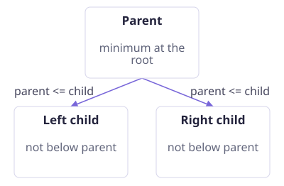

# Heaps and priority queues

Maintain a partial order for repeated minimum extraction.

## A heap maintains a partial ordering

Before this chapter: [Keep stored heights consistent with structure](../balanced-trees/README.md)

A priority queue returns an item chosen by priority rather than arrival time. A heap implements it using parent/child comparisons. Sifting repairs the ordering after an insertion or removal; it does not sort all elements.

In a binary min-heap, every parent is no greater than its children. This guarantees a minimum at the root without fully sorting the array. Child positions follow arithmetic indices in the owned vector.

Heap validation should compare every parent-child edge, not require the entire array to be sorted.



Each parent is no greater than its children. Siblings need not be ordered, and the underlying array is not a sorted sequence. Separate tie-breaking rules determine which equivalent-priority value comes first.

Text description: Parent: minimum at the root. Left child: not below parent. Right child: not below parent. Parent → Left child (parent <= child); Parent → Right child (parent <= child).

```cpp
#include <iostream>
#include <optional>
#include <utility>
#include <vector>

struct MinHeap {
    std::vector<int> values;
    void push(int value) {
        values.push_back(value);
        auto at = values.size() - 1;
        while (at > 0) {
            auto parent = (at - 1) / 2;
            if (values[parent] <= values[at])
                break;
            std::swap(values[parent], values[at]);
            at = parent;
        }
    }
    std::optional<int> pop() {
        if (values.empty())
            return std::nullopt;
        int result = values.front();
        values.front() = values.back();
        values.pop_back();
        std::size_t at = 0;
        while (at < values.size()) {
            auto child = at * 2 + 1;
            if (child >= values.size())
                break;
            if (child + 1 < values.size() && values[child + 1] < values[child])
                ++child;
            if (values[at] <= values[child])
                break;
            std::swap(values[at], values[child]);
            at = child;
        }
        return result;
    }
    bool valid() const {
        for (std::size_t i = 1; i < values.size(); ++i)
            if (values[(i - 1) / 2] > values[i])
                return false;
        return true;
    }
};

int main() {
    MinHeap heap;
    for (int value : {5, 2, 8, 1})
        heap.push(value);
    std::cout << "minimum=" << heap.values.front() << " valid=" << heap.valid() << "\n";
}

```

Original program output:

```text
minimum=1 valid=1
```

Insertion sifts a new value toward its parent until the heap condition is restored.

Pitfall: A valid heap is not necessarily globally sorted in array order.

Question: What does the heap invariant guarantee?

1. A minimum at the root
2. Every adjacent array pair is ordered
3. All leaves have equal values

Answer: 1. The parent-child relation establishes the root minimum.

### Run the starter, then try a change

Open `native/examples/heap-order.cpp` in your checkout. From the repository root, use this command in a Linux or Codespaces terminal to compile and run the current file in a fresh temporary directory.

```sh
run_dir=$(mktemp -d) && g++ -std=c++20 -Wall -Wextra -Werror native/examples/heap-order.cpp -o "$run_dir/example" && (cd "$run_dir" && ./example)
```

Replace

```cpp
{5, 2, 8, 1}
```

With

```cpp
{5, 2, 8, 3}
```

Rerun the terminal command. Compare minimum= and valid=. Does a new minimum change the requirement that each parent is no larger than its children?

## Restore order after appending a leaf

Before this chapter: [Keep stored heights consistent with structure](../balanced-trees/README.md)

A newly appended heap element can violate order only along its ancestor path. Sift-up swaps it with a larger parent until the local relation holds or it reaches the root.

The vector owns all elements throughout the operation. An index is reacquired after push_back, avoiding observers into an allocation that may have moved.

```cpp
#include <iostream>
#include <optional>
#include <utility>
#include <vector>

struct MinHeap {
    std::vector<int> values;
    void push(int value) {
        values.push_back(value);
        auto at = values.size() - 1;
        while (at > 0) {
            auto parent = (at - 1) / 2;
            if (values[parent] <= values[at])
                break;
            std::swap(values[parent], values[at]);
            at = parent;
        }
    }
    std::optional<int> pop() {
        if (values.empty())
            return std::nullopt;
        int result = values.front();
        values.front() = values.back();
        values.pop_back();
        std::size_t at = 0;
        while (at < values.size()) {
            auto child = at * 2 + 1;
            if (child >= values.size())
                break;
            if (child + 1 < values.size() && values[child + 1] < values[child])
                ++child;
            if (values[at] <= values[child])
                break;
            std::swap(values[at], values[child]);
            at = child;
        }
        return result;
    }
    bool valid() const {
        for (std::size_t i = 1; i < values.size(); ++i)
            if (values[(i - 1) / 2] > values[i])
                return false;
        return true;
    }
};

int main() {
    MinHeap heap;
    for (int value : {7, 6, 5, 4}) {
        heap.push(value);
        std::cout << heap.values.front();
    }
    std::cout << "\n";
}

```

Original program output:

```text
7654
```

Each newly inserted smaller value travels to the root through its parent path.

Pitfall: Computing (at-1)/2 when at is unsigned zero underflows before division.

Question: Why test at>0 before computing the parent?

1. To prevent duplicate keys
2. To avoid unsigned underflow at the root
3. To force every insertion to allocate

Answer: 2. The root has no parent.

### Run the starter, then try a change

Open `native/examples/sift-up.cpp` in your checkout. From the repository root, use this command in a Linux or Codespaces terminal to compile and run the current file in a fresh temporary directory.

```sh
run_dir=$(mktemp -d) && g++ -std=c++20 -Wall -Wextra -Werror native/examples/sift-up.cpp -o "$run_dir/example" && (cd "$run_dir" && ./example)
```

Replace

```cpp
{7, 6, 5, 4}
```

With

```cpp
{4, 5, 6, 7}
```

Rerun the terminal command. Compare successive minima. Which insertion order continually changes the heap’s top value?

## Restore order after removing the minimum

Before this chapter: [Keep stored heights consistent with structure](../balanced-trees/README.md)

Removing the root leaves a hole filled by the final element. Only a downward path can now violate min-heap order. Choose the smaller child before deciding whether to swap.

The empty case returns no result. The single-element case removes the final value without reading a nonexistent child.

```cpp
#include <iostream>
#include <optional>
#include <utility>
#include <vector>

struct MinHeap {
    std::vector<int> values;
    void push(int value) {
        values.push_back(value);
        auto at = values.size() - 1;
        while (at > 0) {
            auto parent = (at - 1) / 2;
            if (values[parent] <= values[at])
                break;
            std::swap(values[parent], values[at]);
            at = parent;
        }
    }
    std::optional<int> pop() {
        if (values.empty())
            return std::nullopt;
        int result = values.front();
        values.front() = values.back();
        values.pop_back();
        std::size_t at = 0;
        while (at < values.size()) {
            auto child = at * 2 + 1;
            if (child >= values.size())
                break;
            if (child + 1 < values.size() && values[child + 1] < values[child])
                ++child;
            if (values[at] <= values[child])
                break;
            std::swap(values[at], values[child]);
            at = child;
        }
        return result;
    }
    bool valid() const {
        for (std::size_t i = 1; i < values.size(); ++i)
            if (values[(i - 1) / 2] > values[i])
                return false;
        return true;
    }
};

int main() {
    MinHeap heap;
    for (int value : {8, 2, 5, 1})
        heap.push(value);
    while (auto value = heap.pop())
        std::cout << *value;
    std::cout << " empty=" << !heap.pop() << "\n";
}

```

Original program output:

```text
1258 empty=1
```

Repeated minimum extraction produces a sorted sequence even though the internal heap array was only partially ordered.

Pitfall: Always choosing the left child can violate order when the right child is smaller.

Question: Which child should a min-heap sift choose?

1. Always the left child
2. The most recently inserted child
3. The smaller existing child

Answer: 3. The smaller child preserves the local minimum relation after a swap.

### Run the starter, then try a change

Open `native/examples/sift-down.cpp` in your checkout. From the repository root, use this command in a Linux or Codespaces terminal to compile and run the current file in a fresh temporary directory.

```sh
run_dir=$(mktemp -d) && g++ -std=c++20 -Wall -Wextra -Werror native/examples/sift-down.cpp -o "$run_dir/example" && (cd "$run_dir" && ./example)
```

Replace

```cpp
{8, 2, 5, 1}
```

With

```cpp
{8, 2, 2, 1}
```

Rerun the terminal command. Compare the popped sequence and empty=. Do equal keys each get their own output position?

## Make scheduling ties deterministic

Before this chapter: [Keep stored heights consistent with structure](../balanced-trees/README.md)

New terms and notation:

std::pair<A, B> groups two values, whose members are named first and second. The types can differ. A structured binding can give those components local names, but the API still needs to explain what each component means.

A priority queue orders tasks by a comparator. When output order matters, define a tie-breaker such as a monotonically assigned sequence number. Numeric priority alone does not specify the order of equal-priority tasks.

The standard priority_queue is a max-priority adaptor under its comparator convention; choose the comparison carefully for a minimum-first scheduler.

```cpp
#include <functional>
#include <iostream>
#include <queue>
#include <utility>
#include <vector>

int main() {
    using Task = std::pair<int, int>;
    std::priority_queue<Task, std::vector<Task>, std::greater<Task>> tasks;
    tasks.push({2, 0});
    tasks.push({1, 2});
    tasks.push({1, 1});
    while (!tasks.empty()) {
        auto [priority, sequence] = tasks.top();
        tasks.pop();
        std::cout << priority << ":" << sequence << " ";
    }
    std::cout << "done\n";
}

```

Original program output:

```text
1:1 1:2 2:0 done
```

Pair ordering uses priority first and sequence second, producing a deterministic order for the tied priority-one tasks.

Pitfall: A comparator with inverted meaning can silently make a min-first scheduler process the largest priority first.

Question: What resolves equal priorities here?

1. The sequence number
2. The allocation address
3. The thread schedule

Answer: 1. The second pair component is an explicit tie-breaker.

### Run the starter, then try a change

Open `native/examples/priority-ties.cpp` in your checkout. From the repository root, use this command in a Linux or Codespaces terminal to compile and run the current file in a fresh temporary directory.

```sh
run_dir=$(mktemp -d) && g++ -std=c++20 -Wall -Wextra -Werror native/examples/priority-ties.cpp -o "$run_dir/example" && (cd "$run_dir" && ./example)
```

Replace

```cpp
tasks.push({1, 2});
```

With

```cpp
tasks.push({1, 3});
```

Rerun the terminal command. Compare the entries with priority 1. Which part of each pair determines their order when priorities agree?

## Use an independent sorted extraction oracle

Before this chapter: [Keep stored heights consistent with structure](../balanced-trees/README.md)

A heap workload can be validated by collecting every extracted value and comparing it with an independently sorted copy of the inputs. This checks both ordering and multiplicity.

Check the structural invariant between operations as well, because a later operation might expose a corruption hidden by the current minimum.

```cpp
#include <algorithm>
#include <iostream>
#include <optional>
#include <utility>
#include <vector>

struct MinHeap {
    std::vector<int> values;
    void push(int value) {
        values.push_back(value);
        auto at = values.size() - 1;
        while (at > 0) {
            auto parent = (at - 1) / 2;
            if (values[parent] <= values[at])
                break;
            std::swap(values[parent], values[at]);
            at = parent;
        }
    }
    std::optional<int> pop() {
        if (values.empty())
            return std::nullopt;
        int result = values.front();
        values.front() = values.back();
        values.pop_back();
        std::size_t at = 0;
        while (at < values.size()) {
            auto child = at * 2 + 1;
            if (child >= values.size())
                break;
            if (child + 1 < values.size() && values[child + 1] < values[child])
                ++child;
            if (values[at] <= values[child])
                break;
            std::swap(values[at], values[child]);
            at = child;
        }
        return result;
    }
    bool valid() const {
        for (std::size_t i = 1; i < values.size(); ++i)
            if (values[(i - 1) / 2] > values[i])
                return false;
        return true;
    }
};

int main() {
    const std::vector<int> input{3, 1, 3, -2, 8};
    MinHeap heap;
    for (int value : input)
        heap.push(value);
    std::vector<int> actual;
    bool valid = heap.valid();
    while (auto value = heap.pop()) {
        actual.push_back(*value);
        valid = valid && heap.valid();
    }
    auto expected = input;
    std::ranges::sort(expected);
    valid = valid && actual == expected;
    std::cout << "verified=" << valid << "\n";
    return valid ? 0 : 1;
}

```

Original program output:

```text
verified=1
```

The reference retains duplicate threes and the negative value, while invariant checks cover every intermediate heap state.

Pitfall: Checking only that extracted values are sorted would accept a heap that dropped duplicates.

Question: Why compare with the complete sorted input?

1. To reproduce sift-down
2. To check content and multiplicity as well as order
3. To require identical internal array positions

Answer: 2. An independent sequence specifies every expected extraction.

### Run the starter, then try a change

Open `native/examples/heap-reference.cpp` in your checkout. From the repository root, use this command in a Linux or Codespaces terminal to compile and run the current file in a fresh temporary directory.

```sh
run_dir=$(mktemp -d) && g++ -std=c++20 -Wall -Wextra -Werror native/examples/heap-reference.cpp -o "$run_dir/example" && (cd "$run_dir" && ./example)
```

Replace

```cpp
input{3, 1, 3, -2, 8}
```

With

```cpp
input{3, 1, 3, -2, -2}
```

Rerun the terminal command. Compare verified=. Does the sorted reference check preserve both occurrences of the new equal minimum?

## Chapter project

Build a scheduler with deterministic tie-breaking.
