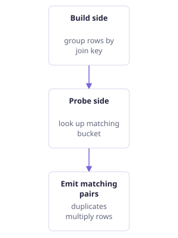

# Joins, grouping, and richer queries

Implement relational operators with explicit empty/duplicate behavior.

## A join must preserve matching multiplicity

Before this chapter: [Compose operators while preserving the query contract](../query-execution/README.md)

A join combines rows matching a condition across inputs. An aggregate combines multiple rows into a result such as a count or sum; grouping computes separate aggregates for different keys. Missing values and empty inputs need explicit rules.

An inner equijoin produces one result for every matching pair of input rows. Duplicate keys on either side therefore multiply results rather than disappearing into one representative.

Nested-loop execution is a clear reference implementation: it checks every left/right pair and supplies an independent oracle for a later indexed or hash join.

```cpp
#include <iostream>
#include <string>
#include <utility>
#include <vector>

int main() {
    const std::vector<std::pair<int, std::string>> left{{1, "A"}, {2, "B"}},
        right{{1, "X"}, {1, "Y"}};
    for (const auto &a : left)
        for (const auto &b : right)
            if (a.first == b.first)
                std::cout << a.second << b.second << "\n";
}

```

Original program output:

```text
AX
AY
```

The left key one matches both right rows, producing two distinct result pairs.

Pitfall: Replacing the right input with a unique-key map can silently discard duplicate join matches.

Question: How many outputs arise from one left row and two matching right rows?

1. One
2. Zero unless keys are unique
3. Two

Answer: 3. Join multiplicity follows matching pairs.

### Run the starter, then try a change

Open `native/examples/nested-loop-join.cpp` in your checkout. From the repository root, use this command in a Linux or Codespaces terminal to compile and run the current file in a fresh temporary directory.

```sh
run_dir=$(mktemp -d) && g++ -std=c++20 -Wall -Wextra -Werror native/examples/nested-loop-join.cpp -o "$run_dir/example" && (cd "$run_dir" && ./example)
```

Replace

```cpp
left{{1, "A"}, {2, "B"}}
```

With

```cpp
left{{1, "A"}, {1, "B"}}
```

Rerun the terminal command. Compare the output pairs. How many right rows match each of the two left rows with key 1?

## Keep every build row for a join key

Before this chapter: [Compose operators while preserving the query contract](../query-execution/README.md)

A hash join groups rows from its build input by key, then looks up each key from its probe input. Store all matching build rows so every matching pair can appear in the result.

The starter uses an ordered map and looks up one supplied key. The vector for that key holds all matching values. Use this run to inspect matches per key. A hash container would use a different lookup mechanism.



Bucket membership produces candidates; the join still relies on equality semantics. Duplicate matches produce multiple pairs. An inner join drops unmatched rows; outer joins need an explicit unmatched-row policy.

Text description: Build side: group rows by join key. Probe side: look up matching bucket. Emit matching pairs: duplicates multiply rows. Build side → Probe side (then); Probe side → Emit matching pairs (then).

```cpp
#include <iostream>
#include <map>
#include <string>
#include <utility>
#include <vector>

int main() {
    const std::vector<std::pair<int, std::string>> build{{1, "X"}, {1, "Y"}, {3, "Z"}};
    std::map<int, std::vector<std::string>> buckets;
    for (const auto &[key, value] : build)
        buckets[key].push_back(value);
    for (const auto &value : buckets.at(1))
        std::cout << "A" << value << "\n";
}

```

Original program output:

```text
AX
AY
```

Both payloads remain in the key-one bucket, matching the nested-loop reference result.

Pitfall: One scalar payload per join key loses multiplicity unless the schema genuinely guarantees uniqueness.

Question: What must the bucket retain?

1. Every build row for the key
2. Only the last inserted row
3. Only the key’s hash number

Answer: 1. The probe must enumerate all matching build rows.

### Run the starter, then try a change

Open `native/examples/hash-join-buckets.cpp` in your checkout. From the repository root, use this command in a Linux or Codespaces terminal to compile and run the current file in a fresh temporary directory.

```sh
run_dir=$(mktemp -d) && g++ -std=c++20 -Wall -Wextra -Werror native/examples/hash-join-buckets.cpp -o "$run_dir/example" && (cd "$run_dir" && ./example)
```

Replace

```cpp
buckets.at(1)
```

With

```cpp
buckets.at(3)
```

Rerun the terminal command. Compare the output pairs. Which stored values come from the selected key’s bucket?

## An unmatched left row needs an explicit absent payload

Before this chapter: [Compose operators while preserving the query contract](../query-execution/README.md)

A left outer join retains every left row even when no right row matches. The result needs an absent right-side representation rather than inventing a real value such as zero or an empty name.

The example uses optional<string> for the projected right payload. A full relational engine also defines null propagation and predicate semantics explicitly.

```cpp
#include <iostream>
#include <map>
#include <optional>
#include <string>

int main() {
    const std::map<int, std::string> right{{1, "X"}};
    for (int key : {1, 2}) {
        std::optional<std::string> matched;
        auto found = right.find(key);
        if (found != right.end())
            matched = found->second;
        std::cout << key << ":" << matched.value_or("<missing>") << "\n";
    }
}

```

Original program output:

```text
1:X
2:<missing>
```

The second left key still produces a result, with an explicitly absent right payload.

Pitfall: Filtering out missing right rows after an outer join can turn the observable result into inner-join behavior.

Question: Does an unmatched left row disappear?

1. Yes
2. Only if its key is positive
3. No

Answer: 3. The left-outer contract retains it with an absent right side.

### Run the starter, then try a change

Open `native/examples/left-outer-join.cpp` in your checkout. From the repository root, use this command in a Linux or Codespaces terminal to compile and run the current file in a fresh temporary directory.

```sh
run_dir=$(mktemp -d) && g++ -std=c++20 -Wall -Wextra -Werror native/examples/left-outer-join.cpp -o "$run_dir/example" && (cd "$run_dir" && ./example)
```

Replace

```cpp
right{{1, "X"}}
```

With

```cpp
right{{1, "X"}, {2, "Y"}}
```

Rerun the terminal command. Compare each key’s printed value. Which left key now matches rather than printing the missing marker?

## Group state by a declared key

Before this chapter: [Compose operators while preserving the query contract](../query-execution/README.md)

Grouping creates one aggregate state per grouping key. A count and a sum have different empty and overflow considerations, and the state should be updated only for rows belonging to that group.

This bounded fixture uses small positive values so its integer sums are representable. A production aggregate needs checked arithmetic and clear null handling.

```cpp
#include <iostream>
#include <map>
#include <utility>
#include <vector>

int main() {
    const std::vector<std::pair<int, int>> rows{{1, 10}, {2, 7}, {1, 20}};
    std::map<int, std::pair<unsigned, int>> groups;
    for (auto [key, value] : rows) {
        auto &state = groups[key];
        ++state.first;
        state.second += value;
    }
    for (auto [key, state] : groups)
        std::cout << key << " count=" << state.first << " sum=" << state.second << "\n";
}

```

Original program output:

```text
1 count=2 sum=30
2 count=1 sum=7
```

Key one accumulates two values and key two accumulates one. Ordered map iteration makes this fixture’s output deterministic.

Pitfall: An aggregate accumulator can overflow even when every input field individually fits its type.

Question: Why is aggregate state keyed separately?

1. The key itself is always the sum
2. Each group needs its own count and sum
3. Grouping removes all duplicates first

Answer: 2. Rows contribute to their matching group’s state.

### Run the starter, then try a change

Open `native/examples/grouped-aggregate.cpp` in your checkout. From the repository root, use this command in a Linux or Codespaces terminal to compile and run the current file in a fresh temporary directory.

```sh
run_dir=$(mktemp -d) && g++ -std=c++20 -Wall -Wextra -Werror native/examples/grouped-aggregate.cpp -o "$run_dir/example" && (cd "$run_dir" && ./example)
```

Replace

```cpp
rows{{1, 10}, {2, 7}, {1, 20}}
```

With

```cpp
rows{{1, 10}, {2, 7}, {1, 20}, {3, 8}}
```

Rerun the terminal command. Compare each group’s count= and sum=. What happens when a previously unseen group arrives last?

## Distinguish row count, present-value count, and absent sum

Before this chapter: [Compose operators while preserving the query contract](../query-execution/README.md)

An aggregate over optional values can count all rows separately from the number of present values. An absent sum for no contributing values differs from a present sum equal to zero.

These semantics need to be declared before execution, especially when outer joins introduce absent fields. The fixture models those distinctions explicitly rather than relying on a magic numeric sentinel.

```cpp
#include <iostream>
#include <optional>
#include <vector>

int main() {
    const std::vector<std::optional<int>> values{0, std::nullopt, 5};
    unsigned present = 0;
    std::optional<int> sum;
    for (auto value : values)
        if (value) {
            ++present;
            sum = sum.value_or(0) + *value;
        }
    std::cout << "rows=" << values.size() << " present=" << present << " sum=" << *sum
              << "\n";
}

```

Original program output:

```text
rows=3 present=2 sum=5
```

The present zero contributes to the value count, while the absent entry contributes only to the row count.

Pitfall: Testing *value as a Boolean would incorrectly treat a present zero as absence.

Question: Does the present zero count as a value?

1. No
2. Only when the sum is nonzero
3. Yes

Answer: 3. Optional engagement is independent of the contained number.

### Run the starter, then try a change

Open `native/examples/aggregate-empty-null.cpp` in your checkout. From the repository root, use this command in a Linux or Codespaces terminal to compile and run the current file in a fresh temporary directory.

```sh
run_dir=$(mktemp -d) && g++ -std=c++20 -Wall -Wextra -Werror native/examples/aggregate-empty-null.cpp -o "$run_dir/example" && (cd "$run_dir" && ./example)
```

Replace

```cpp
values{0, std::nullopt, 5}
```

With

```cpp
values{0, 2, 5}
```

Rerun the terminal command. Compare rows=, present= and sum=. Which counts change when an absent field is replaced by a value?

## Chapter project

Add a join and grouped aggregate with independent expected rows.
