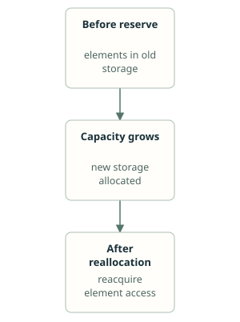
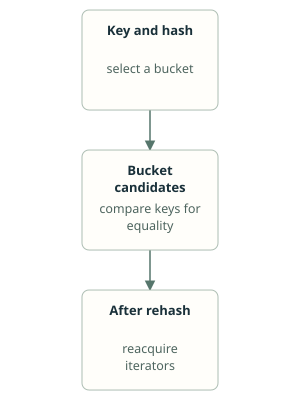

# Container contracts in practice

Choose sequence, ordered, and unordered containers by stability and complexity.

## Reserve capacity without creating elements

Before this chapter: [Choose ordering and lookup contracts deliberately](../standard-library/README.md)

Contiguous storage places elements next to one another. Stable access means a saved way of reaching an element remains valid after a specified change. We compare these promises separately from operation cost.

A vector owns a contiguous sequence. reserve changes capacity, while resize changes the number of live elements. Reallocation invalidates pointers, references, and iterators into its old storage; an index can be retained only when intervening edits preserve positions.



Pointers, references, and iterators into the old vector storage are invalidated. An index is useful only if other edits have not changed positions; reserve changes capacity, not size.

Text description: Before reserve: elements in old storage. Capacity grows: new storage allocated. After reallocation: reacquire element access. Before reserve → Capacity grows (then); Capacity grows → After reallocation (then).

```cpp
#include <iostream>
#include <vector>

int main() {
  std::vector<int> v;
  v.reserve(8);
  v.push_back(3);
  auto index = v.size() - 1;
  v.reserve(32);
  std::cout << v.size() << " " << v.at(index);
}

```

Original program output:

```text
1 3
```

The code retains an index rather than an address across a capacity increase. It reacquires access through at after reallocation.

Pitfall: Do not dereference a saved pointer after a reserve call that reallocates, even when the old bytes appear unchanged.

Question: Which statement correctly describes this example’s contract?

1. reserve constructs every reserved element
2. All vector iterators survive reallocation
3. reserve does not increase size

Answer: 3. reserve does not increase size. The code retains an index rather than an address across a capacity increase. It reacquires access through at after reallocation.

### Run the starter, then try a change

Open `native/examples/lib-vector-invalidation.cpp` in your checkout. From the repository root, use this command in a Linux or Codespaces terminal to compile and run the current file in a fresh temporary directory.

```sh
run_dir=$(mktemp -d) && g++ -std=c++20 -Wall -Wextra -Werror native/examples/lib-vector-invalidation.cpp -o "$run_dir/example" && (cd "$run_dir" && ./example)
```

Replace

```cpp
v.reserve(32);
```

With

```cpp
v.insert(v.begin(), 9);
```

Rerun the terminal command. Compare the printed size and indexed value. Why does the same numeric index now name the inserted element?

## Compare end growth and stable list nodes

Before this chapter: [Choose ordering and lookup contracts deliberately](../standard-library/README.md)

deque supports constant-time end insertion without promising contiguous storage. list owns separate nodes and supports splicing existing nodes between compatible lists without copying their values. Iterator validity and the container to which an iterator belongs are separate questions.

```cpp
#include <deque>
#include <iostream>
#include <list>

int main() {
  std::deque<int> d{2};
  d.push_front(1);
  d.push_back(3);
  std::list<int> a{4, 5}, b{6};
  auto it = a.begin();
  b.splice(b.end(), a, it);
  std::cout << d.front() << " " << d.back() << " " << *it << " " << a.size();
}

```

Original program output:

```text
1 3 4 1
```

The list iterator still denotes 4 after its node moves into b. The deque demonstrates both ends without storing an invalidated deque iterator.

Pitfall: Deque end insertion invalidates its iterators even though references to existing elements remain valid. Cross-list splice requires compatible allocators.

Question: Which statement correctly describes this example’s contract?

1. A spliced list iterator still denotes its moved element
2. A deque is contiguous like vector
3. Splicing always copies the value

Answer: 1. A spliced list iterator still denotes its moved element. The list iterator still denotes 4 after its node moves into b. The deque demonstrates both ends without storing an invalidated deque iterator.

### Run the starter, then try a change

Open `native/examples/lib-deque-list.cpp` in your checkout. From the repository root, use this command in a Linux or Codespaces terminal to compile and run the current file in a fresh temporary directory.

```sh
run_dir=$(mktemp -d) && g++ -std=c++20 -Wall -Wextra -Werror native/examples/lib-deque-list.cpp -o "$run_dir/example" && (cd "$run_dir" && ./example)
```

Replace

```cpp
b.splice(b.end(), a, it);
```

With

```cpp
b.splice(b.begin(), a, it);
```

Rerun the terminal command. Compare the third and fourth values. Does moving the node to a different destination position change what the saved iterator reads?

## Distinguish lookup, insertion, and replacement

Before this chapter: [Choose ordering and lookup contracts deliberately](../standard-library/README.md)

New terms and notation:

std::map<Key, Value> associates each unique key with a stored value and keeps keys in comparison order. Lookup searches by key rather than numeric position. The two types in angle brackets specify the key type and mapped-value type.

Ordered maps keep unique keys in comparator order. find and contains observe the map; operator[] inserts a default mapped value when the key is missing. try_emplace expresses insert-if-absent, while insert_or_assign explicitly permits replacement.

```cpp
#include <iostream>
#include <map>
#include <string>

int main() {
  std::map<std::string, int> m;
  auto [it, added] = m.try_emplace("Ada", 2);
  auto again = m.try_emplace("Ada", 9);
  std::cout << added << " " << again.second << " " << it->second << " "
            << m.contains("Grace");
}

```

Original program output:

```text
1 0 2 0
```

The second insertion reports false and preserves the original mapped value. contains checks another key without inserting it.

Pitfall: Using operator[] merely to check for absence mutates the map and can silently create a record.

Question: Which statement correctly describes this example’s contract?

1. contains inserts a default value
2. Every map lookup is constant time
3. try_emplace preserves an existing mapped value

Answer: 3. try_emplace preserves an existing mapped value. The second insertion reports false and preserves the original mapped value. contains checks another key without inserting it.

### Run the starter, then try a change

Open `native/examples/lib-map-insertion.cpp` in your checkout. From the repository root, use this command in a Linux or Codespaces terminal to compile and run the current file in a fresh temporary directory.

```sh
run_dir=$(mktemp -d) && g++ -std=c++20 -Wall -Wextra -Werror native/examples/lib-map-insertion.cpp -o "$run_dir/example" && (cd "$run_dir" && ./example)
```

Replace

```cpp
auto again = m.try_emplace("Ada", 9);
```

With

```cpp
auto again = m.insert_or_assign("Ada", 9);
```

Rerun the terminal command. Compare the insertion flag and the stored value. Can the value change when the insertion flag is false?

## Hash equality and rehash contracts

Before this chapter: [Choose ordering and lookup contracts deliberately](../standard-library/README.md)

New terms and notation:

A hash function maps a key to a numeric code used to choose a search bucket or starting slot. Different keys may share a hash; checking actual key equality distinguishes them. Equivalent keys must have equal hashes.

Unordered containers provide average constant-time lookup, with linear worst cases. Equivalent keys must produce equal hashes; different keys may collide. reserve plans for a number of elements under the current maximum load factor, while rehash requests bucket capacity.



Equivalent keys must have equal hashes; collisions are permitted. Rehash reorganizes buckets and invalidates iterators, but references and pointers to surviving elements remain valid. No iteration order is promised.

Text description: Key and hash: select a bucket. Bucket candidates: compare keys for equality. After rehash: reacquire iterators. Key and hash → Bucket candidates (then); Bucket candidates → After rehash (then).

```cpp
#include <iostream>
#include <string>
#include <unordered_map>

int main() {
  std::unordered_map<std::string, int> counts;
  counts.max_load_factor(0.7f);
  counts.reserve(20);
  ++counts["Ada"];
  ++counts["Ada"];
  counts.rehash(100);
  std::cout << counts.at("Ada") << " " << counts.contains("Grace");
}

```

Original program output:

```text
2 0
```

The example checks values by key after rehash instead of assuming an iteration order. The count survives the bucket reorganization.

Pitfall: Rehash invalidates iterators, though references and pointers to surviving elements remain valid. Never persist an unordered iteration order as a file format.

Question: Which statement correctly describes this example’s contract?

1. Equal keys must have equal hashes
2. Distinct keys must have distinct hashes
3. Hash lookup has guaranteed constant worst-case time

Answer: 1. Equal keys must have equal hashes. The example checks values by key after rehash instead of assuming an iteration order. The count survives the bucket reorganization.

### Run the starter, then try a change

Open `native/examples/lib-unordered-contracts.cpp` in your checkout. From the repository root, use this command in a Linux or Codespaces terminal to compile and run the current file in a fresh temporary directory.

```sh
run_dir=$(mktemp -d) && g++ -std=c++20 -Wall -Wextra -Werror native/examples/lib-unordered-contracts.cpp -o "$run_dir/example" && (cd "$run_dir" && ./example)
```

Replace

```cpp
counts.rehash(100);
```

With

```cpp
counts.rehash(200);
```

Rerun the terminal command. Compare the count for Ada and the membership result for Grace. Does changing the requested bucket count change the stored data?

## Chapter project

Build a frequency index and document invalidation for each update.
