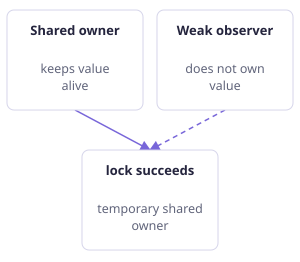
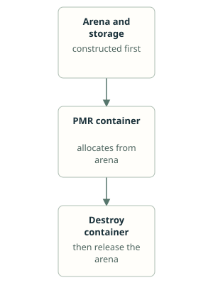

# Filesystem and allocation boundaries

Handle host errors, path semantics, shared ownership, and allocation lifetimes.

## Inspect host filesystem failures without throwing

Before this chapter: [A weak observer can detect expired shared ownership](../lifetimes-views/README.md)

An allocator provides storage for objects; a memory resource lets allocation behavior be selected at runtime. Resource lifetime must cover every live allocation that depends on it. Filesystem operations also report host failures that a path’s spelling cannot predict.

Filesystem operations depend on host state and permissions. Many provide error_code overloads that report operating-system failures without a filesystem_error exception. Paths are names rather than stable object identities, and a successful preflight check does not make a subsequent operation race-free.

```cpp
#include <filesystem>
#include <iostream>
#include <system_error>

int main() {
  std::error_code ec;
  auto here = std::filesystem::current_path(ec);
  bool valid = !ec && !here.empty();
  std::cout << valid;
}

```

Original program output:

```text
1
```

The native program checks the error before using the returned path. It prints a property rather than a machine-specific working directory.

Pitfall: exists followed by open has a time-of-check/time-of-use race. Security-sensitive operations need appropriate host APIs and handle-based policies.

Question: Which statement correctly describes this example’s contract?

1. Check the error code before trusting a result
2. A path check guarantees a later open succeeds
3. Filesystem paths are portable object identities

Answer: 1. Check the error code before trusting a result. The native program checks the error before using the returned path. It prints a property rather than a machine-specific working directory.

### Run the starter, then try a change

Open `native/examples/lib-filesystem-errors.cpp` in your checkout. From the repository root, use this command in a Linux or Codespaces terminal to compile and run the current file in a fresh temporary directory.

```sh
run_dir=$(mktemp -d) && g++ -std=c++20 -Wall -Wextra -Werror native/examples/lib-filesystem-errors.cpp -o "$run_dir/example" && (cd "$run_dir" && ./example)
```

Replace

```cpp
std::filesystem::current_path(ec)
```

With

```cpp
std::filesystem::canonical("missing-for-this-experiment", ec)
```

Rerun the terminal command. Run in a temporary directory with no entry of that name. Compare the printed success flag. Which version needs the named filesystem entry to exist?

## Treat path normalization as lexical processing

Before this chapter: [A weak observer can detect expired shared ownership](../lifetimes-views/README.md)

A path represents a host-dependent path syntax. lexically_normal simplifies components without accessing the filesystem, while canonical resolves existing objects through the filesystem. Lexical normalization does not prove containment when symbolic links or host-specific path rules are involved.

```cpp
#include <filesystem>
#include <iostream>

int main() {
  std::filesystem::path p("alpha/../beta/file.txt");
  auto normalized = p.lexically_normal();
  std::cout << normalized.filename().string() << " "
            << normalized.extension().string();
}

```

Original program output:

```text
file.txt .txt
```

The filename and extension are inspected after a lexical cleanup. No file is created and no existence claim is made.

Pitfall: Do not use a string prefix check to enforce directory containment. Symlinks, drive syntax, and case rules can invalidate simplistic assumptions.

Question: Which statement correctly describes this example’s contract?

1. lexically_normal resolves all symbolic links
2. Lexical normalization does not access the filesystem
3. A normalized path proves safe directory containment

Answer: 2. Lexical normalization does not access the filesystem. The filename and extension are inspected after a lexical cleanup. No file is created and no existence claim is made.

### Run the starter, then try a change

Open `native/examples/lib-path-components.cpp` in your checkout. From the repository root, use this command in a Linux or Codespaces terminal to compile and run the current file in a fresh temporary directory.

```sh
run_dir=$(mktemp -d) && g++ -std=c++20 -Wall -Wextra -Werror native/examples/lib-path-components.cpp -o "$run_dir/example" && (cd "$run_dir" && ./example)
```

Replace

```cpp
alpha/../beta/file.txt
```

With

```cpp
alpha/../beta/file.csv
```

Rerun the terminal command. Compare the final component and extension. Which operation uses the path text without opening a file?

## Observe shared state without creating a cycle

Before this chapter: [A weak observer can detect expired shared ownership](../lifetimes-views/README.md)

shared_ptr shares ownership through a control block. weak_ptr observes that ownership without extending the managed object’s lifetime. lock obtains a temporary shared owner atomically with respect to the control block’s lifetime, avoiding a separate check-then-access protocol.



A successful lock holds ownership while the value is used. Once strong ownership ends, later lock attempts fail. The arrows describe lifetime relationships, not synchronization of mutable object state.

Text description: Shared owner: keeps value alive. Weak observer: does not own value. lock succeeds: temporary shared owner. Shared owner → lock succeeds (shared lifetime); Weak observer → lock succeeds (lock if alive, dashed arrow).

```cpp
#include <iostream>
#include <memory>

int main() {
  std::weak_ptr<int> observer;
  {
    auto owner = std::make_shared<int>(7);
    observer = owner;
    if (auto locked = observer.lock())
      std::cout << *locked << " ";
  }
  std::cout << observer.expired();
}

```

Original program output:

```text
7 1
```

The first lock keeps the integer alive while it is used. Once the scope ends, only a weak observer remains and expired is true.

Pitfall: Shared ownership of lifetime does not synchronize reads and writes to the managed object. Reference cycles made entirely of shared_ptr owners will not collect themselves.

Question: Which statement correctly describes this example’s contract?

1. shared_ptr automatically makes the object thread-safe
2. weak_ptr does not keep the object alive
3. shared ownership cycles are automatically collected

Answer: 2. weak_ptr does not keep the object alive. The first lock keeps the integer alive while it is used. Once the scope ends, only a weak observer remains and expired is true.

### Run the starter, then try a change

Open `native/examples/lib-weak-ownership.cpp` in your checkout. From the repository root, use this command in a Linux or Codespaces terminal to compile and run the current file in a fresh temporary directory.

```sh
run_dir=$(mktemp -d) && g++ -std=c++20 -Wall -Wextra -Werror native/examples/lib-weak-ownership.cpp -o "$run_dir/example" && (cd "$run_dir" && ./example)
```

Replace

```cpp
std::make_shared<int>(7)
```

With

```cpp
std::make_shared<int>(12)
```

Rerun the terminal command. Compare the observed value and expired flag. Which output is about the value and which indicates the owner’s lifetime ended?

## Bound an allocation resource lifetime

Before this chapter: [A weak observer can detect expired shared ownership](../lifetimes-views/README.md)

Polymorphic allocators select a runtime memory_resource while retaining the container’s value interface. A monotonic resource reclaims allocation storage as a group rather than on each individual deallocation. Its storage and the resource object must outlive every allocation still in use.



The resource and its backing storage must outlive active allocations. Releasing early invalidates storage still held by containers; a null upstream makes an exceeded budget fail explicitly.

Text description: Arena and storage: constructed first. PMR container: allocates from arena. Destroy container: then release the arena. Arena and storage → PMR container (then); PMR container → Destroy container (then).

```cpp
#include <array>
#include <cstddef>
#include <iostream>
#include <memory_resource>
#include <vector>

int main() {
  std::array<std::byte, 512> buffer{};
  std::pmr::monotonic_buffer_resource arena(buffer.data(), buffer.size(),
                                            std::pmr::null_memory_resource());
  {
    std::pmr::vector<int> values(&arena);
    values.reserve(4);
    values.push_back(7);
    std::cout << values.front();
  }
  arena.release();
}

```

Original program output:

```text
7
```

The vector is destroyed before release. A null upstream resource makes exceeding the supplied storage an explicit allocation failure instead of a hidden heap fallback.

Pitfall: Calling release while containers still hold allocations invalidates their storage. Allocation failure remains possible, including alignment and capacity overhead.

Question: Which statement correctly describes this example’s contract?

1. The resource must outlive containers using its allocations
2. release safely updates all live container pointers
3. A stack buffer always prevents upstream allocation

Answer: 1. The resource must outlive containers using its allocations. The vector is destroyed before release. A null upstream resource makes exceeding the supplied storage an explicit allocation failure instead of a hidden heap fallback.

### Run the starter, then try a change

Open `native/examples/lib-pmr-lifetimes.cpp` in your checkout. From the repository root, use this command in a Linux or Codespaces terminal to compile and run the current file in a fresh temporary directory.

```sh
run_dir=$(mktemp -d) && g++ -std=c++20 -Wall -Wextra -Werror native/examples/lib-pmr-lifetimes.cpp -o "$run_dir/example" && (cd "$run_dir" && ./example)
```

Replace

```cpp
values.push_back(7)
```

With

```cpp
values.push_back(8)
```

Rerun the terminal command. Compare the printed first value. Is the vector still destroyed before release makes the arena’s storage reusable?

## Chapter project

Design a native file adapter and a bounded temporary-allocation policy.
