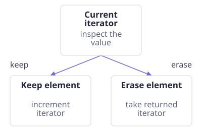
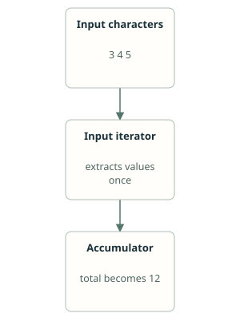

# Iterator categories and invalidation

Use iterator capabilities, sentinels, adapters, and erase results safely.

## Match operations to iterator capabilities

Before this chapter: [Hash equality and rehash contracts](../library-containers/README.md)

An iterator category specifies the navigation an iterator supports. Input iteration can be single-pass; forward iteration supports repeated traversal; bidirectional iteration can step backward; random access can jump by an offset. A sentinel is an end marker used to stop traversal.

Random-access iterators support constant-time differences and jumps. A list iterator is bidirectional: reaching a distant element requires repeated increments. Generic interfaces should constrain the operations they need rather than assuming every iterator behaves like a pointer.

```cpp
#include <iostream>
#include <iterator>
#include <list>
#include <vector>

int main() {
  std::vector<int> v{2, 4, 6};
  std::list<int> l{2, 4, 6};
  auto it = l.begin();
  std::advance(it, 2);
  std::cout << v.end() - v.begin() << " " << *it;
}

```

Original program output:

```text
3 6
```

The vector difference counts three elements. advance reaches the list value 6 by walking two links.

Pitfall: std::distance on a list is linear; repeated distance calls inside a loop can create quadratic work.

Question: Which statement correctly describes this example’s contract?

1. Advancing a list iterator takes linear steps
2. Every iterator supports subtraction
3. Iterator category determines element ownership

Answer: 1. Advancing a list iterator takes linear steps. The vector difference counts three elements. advance reaches the list value 6 by walking two links.

### Run the starter, then try a change

Open `native/examples/lib-iterator-categories.cpp` in your checkout. From the repository root, use this command in a Linux or Codespaces terminal to compile and run the current file in a fresh temporary directory.

```sh
run_dir=$(mktemp -d) && g++ -std=c++20 -Wall -Wextra -Werror native/examples/lib-iterator-categories.cpp -o "$run_dir/example" && (cd "$run_dir" && ./example)
```

Replace

```cpp
std::advance(it, 2);
```

With

```cpp
std::advance(it, 1);
```

Rerun the terminal command. Compare the two numbers. Which count describes a vector range, and which result follows the list iterator?

## Continue traversal using erase’s result

Before this chapter: [Hash equality and rehash contracts](../library-containers/README.md)

Erasing from a vector invalidates iterators and references at or after the erased position. erase returns a valid iterator to the next surviving element, possibly end. A loop must decide whether to advance based on whether it erased an element.



The keep branch increments. The erase branch uses the iterator returned by vector::erase without incrementing again; the old iterator and later vector positions are invalidated.

Text description: Current iterator: inspect the value. Keep element: increment iterator. Erase element: take returned iterator. Current iterator → Keep element (keep); Current iterator → Erase element (erase).

```cpp
#include <iostream>
#include <vector>

int main() {
  std::vector<int> v{1, 2, 4, 3};
  for (auto it = v.begin(); it != v.end();) {
    if (*it % 2 == 0)
      it = v.erase(it);
    else
      ++it;
  }
  for (int n : v)
    std::cout << n;
}

```

Original program output:

```text
13
```

Two adjacent even values are removed without skipping either. The iterator returned by erase replaces the invalid old iterator.

Pitfall: Incrementing an invalid iterator or incrementing again immediately after erase can skip elements or violate a precondition.

Question: Which statement correctly describes this example’s contract?

1. Every vector iterator survives erase
2. Always increment after erase
3. Use the iterator returned by erase

Answer: 3. Use the iterator returned by erase. Two adjacent even values are removed without skipping either. The iterator returned by erase replaces the invalid old iterator.

### Run the starter, then try a change

Open `native/examples/lib-erase-return.cpp` in your checkout. From the repository root, use this command in a Linux or Codespaces terminal to compile and run the current file in a fresh temporary directory.

```sh
run_dir=$(mktemp -d) && g++ -std=c++20 -Wall -Wextra -Werror native/examples/lib-erase-return.cpp -o "$run_dir/example" && (cd "$run_dir" && ./example)
```

Replace

```cpp
v{1, 2, 4, 3}
```

With

```cpp
v{2, 4, 6, 8}
```

Rerun the terminal command. Compare the retained sequence. When every value is erased, what makes the loop stop safely?

## Insert through an output iterator

Before this chapter: [Hash equality and rehash contracts](../library-containers/README.md)

An output iterator describes where produced values go. back_inserter adapts push_back into assignment through an iterator, growing the destination as needed. In contrast, copying into begin on an empty vector does not create destination elements.

```cpp
#include <algorithm>
#include <iostream>
#include <iterator>
#include <vector>

int main() {
  std::vector<int> a{1, 2, 3}, b;
  std::transform(a.begin(), a.end(), std::back_inserter(b),
                 [](int n) { return n * n; });
  for (int n : b)
    std::cout << n << " ";
}

```

Original program output:

```text
1 4 9 
```

transform emits one square per input element; the adapter inserts each result into b.

Pitfall: reserve alone is not enough to make b.begin a writable range of initialized elements. Resize first or use an insertion adapter.

Question: Which statement correctly describes this example’s contract?

1. reserve makes begin writable for capacity elements
2. back_inserter grows the destination
3. transform always resizes its destination

Answer: 2. back_inserter grows the destination. transform emits one square per input element; the adapter inserts each result into b.

### Run the starter, then try a change

Open `native/examples/lib-output-adapters.cpp` in your checkout. From the repository root, use this command in a Linux or Codespaces terminal to compile and run the current file in a fresh temporary directory.

```sh
run_dir=$(mktemp -d) && g++ -std=c++20 -Wall -Wextra -Werror native/examples/lib-output-adapters.cpp -o "$run_dir/example" && (cd "$run_dir" && ./example)
```

Replace

```cpp
a{1, 2, 3}, b
```

With

```cpp
a{}, b
```

Rerun the terminal command. Compare the output sequence. How many elements does back_inserter produce for the empty input?

## Treat stream iteration as single pass

Before this chapter: [Hash equality and rehash contracts](../library-containers/README.md)

Input iterators can represent a single-pass source. Reading advances shared stream state, so copying an input iterator does not provide an independently rewindable sequence. A default stream iterator acts as the end sentinel once extraction fails or input ends.



The stream is consumed as accumulation proceeds. Copying an input iterator does not produce an independently rewindable source; materialize values when multiple passes are needed.

Text description: Input characters: 3 4 5. Input iterator: extracts values once. Accumulator: total becomes 12. Input characters → Input iterator (then); Input iterator → Accumulator (then).

```cpp
#include <iostream>
#include <iterator>
#include <numeric>
#include <sstream>

int main() {
  std::istringstream input("3 4 5");
  std::istream_iterator<int> first(input), last;
  std::cout << std::accumulate(first, last, 0);
}

```

Original program output:

```text
12
```

accumulate consumes all three integers and produces their sum without materializing a vector.

Pitfall: Do not measure a single-pass range with distance and then expect a second traversal to read the same input.

Question: Which statement correctly describes this example’s contract?

1. Copying an input iterator rewinds the stream
2. Every input iterator is multipass
3. Stream input iteration consumes the source

Answer: 3. Stream input iteration consumes the source. accumulate consumes all three integers and produces their sum without materializing a vector.

### Run the starter, then try a change

Open `native/examples/lib-stream-iterators.cpp` in your checkout. From the repository root, use this command in a Linux or Codespaces terminal to compile and run the current file in a fresh temporary directory.

```sh
run_dir=$(mktemp -d) && g++ -std=c++20 -Wall -Wextra -Werror native/examples/lib-stream-iterators.cpp -o "$run_dir/example" && (cd "$run_dir" && ./example)
```

Replace

```cpp
3 4 5
```

With

```cpp
3 bad 5
```

Rerun the terminal command. Compare the sums. At which item does the integer iterator stop?

## Chapter project

Write a generic range copier without assuming random access.
