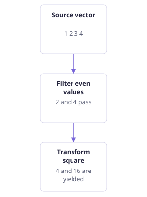

# Ranges, views, and borrowed lifetimes

Compose lazy views while tracking ownership, repeated work, and projections.

## Observe a lazy pipeline before materializing

Before this chapter: [Find a duplicate interval with equal_range](../library-algorithms/README.md)

A range gives a beginning and an end for traversal. A view is a lightweight range description; a lazy view performs work when visited rather than storing all results in advance. A projection selects the part of an element used by an operation.

A view is a lightweight range abstraction, not necessarily a container of computed results. filter and transform usually perform work during iteration. This lvalue pipeline borrows the vector, so the source must outlive its use and iterator invalidation rules still apply.



These are conceptual stages, not three stored containers. This pipeline borrows the source vector; each traversal performs work and must respect source lifetime and invalidation.

Text description: Source vector: 1 2 3 4. Filter even values: 2 and 4 pass. Transform square: 4 and 16 are yielded. Source vector → Filter even values (then); Filter even values → Transform square (then).

```cpp
#include <iostream>
#include <ranges>
#include <vector>

int main() {
  std::vector<int> v{1, 2, 3, 4};
  auto even = v | std::views::filter([](int n) { return n % 2 == 0; }) |
              std::views::transform([](int n) { return n * n; });
  for (int n : even)
    std::cout << n << " ";
}

```

Original program output:

```text
4 16 
```

Iteration selects two even values and computes their squares on demand. No result vector is created.

Pitfall: Returning a view that refers to a local vector leaves a dangling source. Do not assume every view owns its input.

Question: Which statement correctly describes this example’s contract?

1. The source vector must outlive this borrowed pipeline
2. Every view owns a copy of its source
3. Creating transform eagerly computes all results

Answer: 1. The source vector must outlive this borrowed pipeline. Iteration selects two even values and computes their squares on demand. No result vector is created.

### Run the starter, then try a change

Open `native/examples/lib-lazy-views.cpp` in your checkout. From the repository root, use this command in a Linux or Codespaces terminal to compile and run the current file in a fresh temporary directory.

```sh
run_dir=$(mktemp -d) && g++ -std=c++20 -Wall -Wextra -Werror native/examples/lib-lazy-views.cpp -o "$run_dir/example" && (cd "$run_dir" && ./example)
```

Replace

```cpp
n % 2 == 0
```

With

```cpp
n % 2 != 0
```

Rerun the terminal command. Compare the squared values. Which input values reach the transform after changing the filter?

## Sort records through a projection

Before this chapter: [Find a duplicate interval with equal_range](../library-algorithms/README.md)

Ranges algorithms can apply a projection before comparison. A member pointer expresses which field participates while leaving the comparison itself reusable. Sorting by one field does not automatically choose a deterministic secondary order for equal keys.

```cpp
#include <algorithm>
#include <iostream>
#include <string>
#include <vector>

struct Row {
  std::string name;
  int score;
};
int main() {
  std::vector<Row> rows{{"Ada", 3}, {"Grace", 1}};
  std::ranges::sort(rows, {}, &Row::score);
  for (const auto &r : rows)
    std::cout << r.name << " ";
}

```

Original program output:

```text
Grace Ada 
```

The score projection puts Grace before Ada. The record values remain intact; only their positions change.

Pitfall: ranges::sort is not stable. Add a secondary key or use a stable algorithm when equal-score order is part of the contract.

Question: Which statement correctly describes this example’s contract?

1. The projection chooses the compared field
2. A projection strips other fields from each record
3. ranges::sort guarantees stable equal-key order

Answer: 1. The projection chooses the compared field. The score projection puts Grace before Ada. The record values remain intact; only their positions change.

### Run the starter, then try a change

Open `native/examples/lib-ranges-projections.cpp` in your checkout. From the repository root, use this command in a Linux or Codespaces terminal to compile and run the current file in a fresh temporary directory.

```sh
run_dir=$(mktemp -d) && g++ -std=c++20 -Wall -Wextra -Werror native/examples/lib-ranges-projections.cpp -o "$run_dir/example" && (cd "$run_dir" && ./example)
```

Replace

```cpp
{"Grace", 1}
```

With

```cpp
{"Grace", 4}
```

Rerun the terminal command. Compare the printed order of names. Which field controls the order even though the program prints a different field?

## Bound a generated range before consuming it

Before this chapter: [Find a duplicate interval with equal_range](../library-algorithms/README.md)

An unbounded iota view can generate successive values without storing them. A terminating consumer must impose a suitable bound. take limits how many values are requested, but does not make arbitrary source operations safe or remove numeric representability limits.

```cpp
#include <iostream>
#include <ranges>

int main() {
  auto values = std::views::iota(1) | std::views::take(4);
  for (int n : values)
    std::cout << n << " ";
}

```

Original program output:

```text
1 2 3 4 
```

The take adaptor stops iteration after four integers, so the unbounded source is never exhausted.

Pitfall: Filtering an infinite source for a condition that never matches may never produce the first value, even when followed by take(1).

Question: Which statement correctly describes this example’s contract?

1. Every view is finite
2. The consumer must establish termination
3. take prevents any upstream nontermination

Answer: 2. The consumer must establish termination. The take adaptor stops iteration after four integers, so the unbounded source is never exhausted.

### Run the starter, then try a change

Open `native/examples/lib-ranges-take.cpp` in your checkout. From the repository root, use this command in a Linux or Codespaces terminal to compile and run the current file in a fresh temporary directory.

```sh
run_dir=$(mktemp -d) && g++ -std=c++20 -Wall -Wextra -Werror native/examples/lib-ranges-take.cpp -o "$run_dir/example" && (cd "$run_dir" && ./example)
```

Replace

```cpp
std::views::take(4)
```

With

```cpp
std::views::take(0)
```

Rerun the terminal command. Compare the produced range. How does the take limit affect the number of values requested from iota?

## Keep algorithm results tied to a living range

Before this chapter: [Find a duplicate interval with equal_range](../library-algorithms/README.md)

New terms and notation:

decltype(expression) names the type determined by an expression without running that expression. Generic code uses it to describe or inspect types; it is not a runtime conversion of a value.

Some ranges algorithms return dangling instead of an iterator when passed a temporary non-borrowed range. This catches one class of lifetime mistake at the type level. borrowed_range concerns whether iterators can outlive the range object, not whether the underlying elements live forever.

```cpp
#include <algorithm>
#include <iostream>
#include <ranges>
#include <type_traits>
#include <vector>

int main() {
  std::vector<int> v{2, 4, 6};
  auto it = std::ranges::find(v, 4);
  using Result = decltype(std::ranges::find(std::vector<int>{2, 4}, 4));
  std::cout << *it << " " << std::is_same_v<Result, std::ranges::dangling>;
}

```

Original program output:

```text
4 1
```

The lvalue vector yields a usable iterator. The temporary-vector expression is inspected only as a type and yields dangling.

Pitfall: A span can be a borrowed range while still referring to destroyed storage. The range concept does not prove ownership of its elements.

Question: Which statement correctly describes this example’s contract?

1. borrowed_range guarantees eternal storage
2. A temporary vector returns an owning iterator
3. A borrowed range still needs live underlying elements

Answer: 3. A borrowed range still needs live underlying elements. The lvalue vector yields a usable iterator. The temporary-vector expression is inspected only as a type and yields dangling.

### Run the starter, then try a change

Open `native/examples/lib-borrowed-result.cpp` in your checkout. From the repository root, use this command in a Linux or Codespaces terminal to compile and run the current file in a fresh temporary directory.

```sh
run_dir=$(mktemp -d) && g++ -std=c++20 -Wall -Wextra -Werror native/examples/lib-borrowed-result.cpp -o "$run_dir/example" && (cd "$run_dir" && ./example)
```

Replace

```cpp
std::ranges::find(v, 4)
```

With

```cpp
std::ranges::find(v, 6)
```

Rerun the terminal command. Compare the found value and the dangling flag. Does changing the searched value change the temporary range’s result type?

## Chapter project

Create an owned report from a borrowed filtering pipeline.
