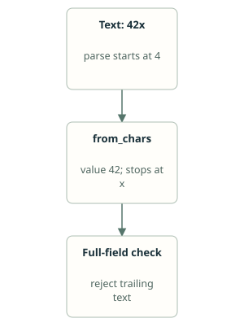

# Text conversion, formatting, and stream state

Check complete parses, preserve stream state, and choose formatting facilities deliberately.

## Require complete numeric consumption

Before this chapter: [Choose callable storage and captured state](../library-values/README.md)

Parsing turns characters into a value after checking their spelling. Formatting turns a value into characters for presentation. A stream has state flags that remember success or failure; clearing a flag and removing invalid input are different steps.

from_chars reports both an error code and a stopping pointer. A successful prefix parse is not necessarily a valid complete field. It avoids locale-dependent stream extraction, but its accepted syntax differs from convenience conversion functions, including whitespace handling.



Accept a complete integer field only when the error code is clear and the stopping pointer reaches the end. Range errors and an invalid first character are distinct failure cases.

Text description: Text: 42x: parse starts at 4. from_chars: value 42; stops at x. Full-field check: reject trailing text. Text: 42x → from_chars (then); from_chars → Full-field check (then).

```cpp
#include <charconv>
#include <iostream>
#include <string_view>
#include <system_error>

int main() {
  for (std::string_view text : {"42", "42x", "99999999999999999999"}) {
    int n = 0;
    auto [end, ec] = std::from_chars(text.data(), text.data() + text.size(), n);
    std::cout << (ec == std::errc{} && end == text.data() + text.size()) << " ";
  }
}

```

Expected output:

```text
1 0 0 
```

42 consumes the full input. 42x leaves trailing text, and the final value is outside the range of int.

Pitfall: Checking only ec accepts trailing junk. On a failed conversion, do not consume the result as if a valid value were produced.

Question: Which statement correctly describes this example’s contract?

1. A successful prefix guarantees valid input
2. Success requires both a clear error code and full consumption
3. from_chars always skips leading whitespace

Answer: 2. Success requires both a clear error code and full consumption. 42 consumes the full input. 42x leaves trailing text, and the final value is outside the range of int.

Experiment: Test leading whitespace, a plus sign, negative values, and empty input. Define the exact grammar before choosing whether preprocessing is allowed.

## Recover deliberately after failed extraction

Before this chapter: [Choose callable storage and captured state](../library-values/README.md)

New terms and notation:

std::numeric_limits<T> describes limits of a numeric type T. For whole-number types, min() and max() give the smallest and largest representable values; use those limits before arithmetic or conversion can exceed them.

Formatted extraction records failures in stream state. Once failbit is set, later extraction normally does no work until state is cleared. Clearing flags does not remove the offending characters; recovery must also establish a new input boundary.

```cpp
#include <iostream>
#include <limits>
#include <sstream>
#include <string>

int main() {
  std::istringstream input("bad\n42\n");
  int value = 0;
  input >> value;
  std::cout << input.fail() << " ";
  input.clear();
  input.ignore(std::numeric_limits<std::streamsize>::max(), '\n');
  input >> value;
  std::cout << value;
}

```

Expected output:

```text
1 42
```

The code clears the error and discards the bad line before reading 42 from the next line.

Pitfall: Calling clear alone can retry the same invalid characters forever. Mixing getline and formatted extraction also requires accounting for a pending newline.

Question: Which statement correctly describes this example’s contract?

1. clear discards the entire bad line
2. A failed stream automatically retries on the next line
3. Recovery needs both state repair and input-position repair

Answer: 3. Recovery needs both state repair and input-position repair. The code clears the error and discards the bad line before reading 42 from the next line.

Experiment: Try a line containing a numeric prefix followed by junk. Compare whole-line parsing with extraction followed by delimiter validation.

## Control numeric presentation without changing values

Before this chapter: [Choose callable storage and captured state](../library-values/README.md)

Stream manipulators affect presentation state. fixed and setprecision persist for later floating-point insertions, while setw normally applies to the next formatted field. Formatting is not a binary serialization format, and locale can change the textual conventions.

```cpp
#include <iomanip>
#include <iostream>
#include <sstream>

int main() {
  std::ostringstream out;
  out << std::fixed << std::setprecision(2) << 1.25 << " " << 2.0;
  std::cout << out.str();
}

```

Expected output:

```text
1.25 2.00
```

The same persistent precision produces two digits after the decimal point for both values.

Pitfall: Do not assume precision means fractional digits under the default floating format; it normally controls significant digits instead.

Question: Which statement correctly describes this example’s contract?

1. setprecision rounds the stored floating value permanently
2. All stream manipulators affect only one insertion
3. fixed makes precision count fractional digits

Answer: 3. fixed makes precision count fractional digits. The same persistent precision produces two digits after the decimal point for both values.

Experiment: Compare defaultfloat, fixed, and scientific. Format through a local string stream to avoid leaking presentation state into a caller-owned stream.

## Use C++20 format with an explicit support boundary

Before this chapter: [Choose callable storage and captured state](../library-values/README.md)

New terms and notation:

Alignment is a restriction on the storage positions where a type’s objects may be placed. A block with enough bytes can still be unsuitable if its starting position does not meet that restriction.

std::format provides typed replacement fields and returns an owning string. Format specifications belong to the selected argument’s formatter, so syntax valid for integers may not be valid for arbitrary user types. C++20 language mode alone does not establish library feature availability.

```cpp
#include <format>
#include <iostream>
#include <string>

int main() {
  std::string text = std::format("id={:04d} score={:.1f}", 7, 2.5);
  std::cout << text;
}

```

Expected output:

```text
id=0007 score=2.5
```

The integer field receives zero padding to width four, and the floating field uses one fractional digit.

Pitfall: The browser toolchain and the native standard library may implement different format subsets. Detect the library feature and test the exact formats used by the application.

Question: Which statement correctly describes this example’s contract?

1. Enabling C++20 guarantees every format implementation is complete
2. Library support must be checked independently of the language mode
3. std::format modifies each argument in place

Answer: 2. Library support must be checked independently of the language mode. The integer field receives zero padding to width four, and the floating field uses one fractional digit.

Experiment: Add escaped braces, alignment, and a positional field. Compare a compile-time format string with runtime vformat error handling on a supported native library.

## Chapter project

Build a strict text import with separate syntax and range errors.
