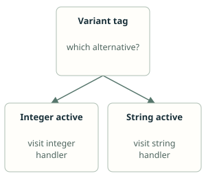

# Vocabulary types and callable utilities

Model absence, alternatives, grouped values, and callable ownership explicitly.

## Represent absence without a magic value

Before this chapter: [Keep algorithm results tied to a living range](../library-ranges/README.md)

A vocabulary type represents a common kind of result: optional represents absence, variant represents an alternative, and tuple groups values by position. A callable is anything that can be invoked like a function, including a lambda.

optional stores either a value or disengagement. It is useful when absence is a normal outcome rather than an exceptional failure. Dereference requires engagement; value reports disengagement with bad_optional_access, while value_or produces an alternative value.

```cpp
#include <iostream>
#include <optional>
#include <string>

int main() {
  std::optional<std::string> name;
  std::cout << name.has_value() << " " << name.value_or("unknown");
  name = "Ada";
  std::cout << " " << name.value();
}

```

Original program output:

```text
0 unknown Ada
```

The empty optional yields a fallback. After assignment, value accesses the stored name.

Pitfall: value_or evaluates its argument before the call, even when a stored value exists. Do not use it to defer expensive or effectful work.

Question: Which statement correctly describes this example’s contract?

1. An empty optional contains a default string
2. Check engagement before dereferencing
3. value_or always evaluates its fallback lazily

Answer: 2. Check engagement before dereferencing. The empty optional yields a fallback. After assignment, value accesses the stored name.

### Run the starter, then try a change

Open `native/examples/lib-optional-access.cpp` in your checkout. From the repository root, use this command in a Linux or Codespaces terminal to compile and run the current file in a fresh temporary directory.

```sh
run_dir=$(mktemp -d) && g++ -std=c++20 -Wall -Wextra -Werror native/examples/lib-optional-access.cpp -o "$run_dir/example" && (cd "$run_dir" && ./example)
```

Replace

```cpp
name.value_or("unknown")
```

With

```cpp
name.value_or("missing")
```

Rerun the terminal command. Compare the fallback and the final stored name. Does reading a fallback assign that fallback to the optional?

## Handle each tagged alternative

Before this chapter: [Keep algorithm results tied to a living range](../library-ranges/README.md)

variant owns one alternative from a closed set and tracks which is active. visit dispatches a callable to that active value, while get_if allows a nonthrowing type check. Some throwing transitions can leave a variant valueless_by_exception; it is not a universal never-empty sum type.



Only the active branch is visited. The visitor must be well-formed for all alternatives. This shows the ordinary active-value case, not a possible valueless_by_exception state.

Text description: Variant tag: which alternative?. Integer active: visit integer handler. String active: visit string handler. Variant tag → Integer active (integer); Variant tag → String active (string).

```cpp
#include <iostream>
#include <string>
#include <type_traits>
#include <variant>

int main() {
  std::variant<int, std::string> value = 7;
  auto show = [](const auto &item) {
    if constexpr (std::is_same_v<std::decay_t<decltype(item)>, int>)
      std::cout << "number=" << item;
    else
      std::cout << "text=" << item;
  };
  std::visit(show, value);
  value = std::string("Ada");
  std::cout << " ";
  std::visit(show, value);
}

```

Original program output:

```text
number=7 text=Ada
```

The visitor instantiates handling for both alternatives and dispatches according to the active tag.

Pitfall: An unchecked get of the wrong alternative throws bad_variant_access. A visitor must support every alternative combination it may receive.

Question: Which statement correctly describes this example’s contract?

1. variant stores all alternatives simultaneously
2. A visitor must handle every possible active alternative
3. get of the wrong type returns a default value

Answer: 2. A visitor must handle every possible active alternative. The visitor instantiates handling for both alternatives and dispatches according to the active tag.

### Run the starter, then try a change

Open `native/examples/lib-variant-visit.cpp` in your checkout. From the repository root, use this command in a Linux or Codespaces terminal to compile and run the current file in a fresh temporary directory.

```sh
run_dir=$(mktemp -d) && g++ -std=c++20 -Wall -Wextra -Werror native/examples/lib-variant-visit.cpp -o "$run_dir/example" && (cd "$run_dir" && ./example)
```

Replace

```cpp
std::variant<int, std::string> value = 7;
```

With

```cpp
std::variant<int, std::string> value = std::string("Grace");
```

Rerun the terminal command. Compare the first labels. Which visitor branch is selected by the active type?

## Expand grouped arguments into a callable

Before this chapter: [Keep algorithm results tied to a living range](../library-ranges/README.md)

New terms and notation:

std::tuple<A, B, ...> groups values with possibly different types by position. std::get<I> selects position I, counting from zero. A tuple of references borrows its referenced objects rather than extending their lifetimes.

tuple groups heterogeneous values by position. apply expands a tuple-like argument list into a call, while tie creates a tuple of references. Positional structure works well for local composition, but named record types often communicate a public domain interface better.

```cpp
#include <functional>
#include <iostream>
#include <tuple>

int main() {
  auto arguments = std::tuple{3, 4};
  auto add = [](int a, int b) { return a + b; };
  std::cout << std::apply(add, arguments) << " ";
  int n = 2;
  auto refs = std::tie(n);
  std::get<0>(refs) = 9;
  std::cout << n;
}

```

Original program output:

```text
7 9
```

apply calls add with two integers. The tied element aliases n, so assignment changes n.

Pitfall: A tuple containing references does not extend the lifetime of their referents. Avoid retaining tied locals beyond their scope.

Question: Which statement correctly describes this example’s contract?

1. tie copies each referenced value
2. apply passes the entire tuple as one argument
3. tie stores references to existing objects

Answer: 3. tie stores references to existing objects. apply calls add with two integers. The tied element aliases n, so assignment changes n.

### Run the starter, then try a change

Open `native/examples/lib-tuple-apply.cpp` in your checkout. From the repository root, use this command in a Linux or Codespaces terminal to compile and run the current file in a fresh temporary directory.

```sh
run_dir=$(mktemp -d) && g++ -std=c++20 -Wall -Wextra -Werror native/examples/lib-tuple-apply.cpp -o "$run_dir/example" && (cd "$run_dir" && ./example)
```

Replace

```cpp
std::tuple{3, 4}
```

With

```cpp
std::tuple{5, 4}
```

Rerun the terminal command. Compare the first result and the final n. Which values are supplied by the tuple and which are reached through tie?

## Choose callable storage and captured state

Before this chapter: [Keep algorithm results tied to a living range](../library-ranges/README.md)

New terms and notation:

Type erasure lets an interface store or use values of different concrete types behind one shared interface. The concrete type still exists; some of its details are hidden from the caller. The chosen wrapper determines copying, allocation and call requirements.

A lambda capture is an ownership decision: value capture stores independent state, while reference capture borrows. std::function provides owning type erasure for copy-constructible targets in C++20, which excludes a lambda owning a unique_ptr. Keeping the concrete callable type avoids that restriction.

```cpp
#include <functional>
#include <iostream>
#include <memory>

int main() {
  int n = 3;
  std::function<int(int)> by_value = [n](int x) { return n + x; };
  auto owner = [p = std::make_unique<int>(5)](int x) { return *p + x; };
  n = 9;
  std::cout << by_value(2) << " " << owner(2);
}

```

Original program output:

```text
5 7
```

The stored value capture retains 3 despite the later assignment to n. The concrete move-only lambda owns its integer.

Pitfall: A stored reference-capturing callback can dangle. Calling an empty std::function throws bad_function_call.

Question: Which statement correctly describes this example’s contract?

1. C++20 std::function requires a copyable target
2. Reference capture extends a local lifetime
3. All lambdas can be stored in std::function

Answer: 1. C++20 std::function requires a copyable target. The stored value capture retains 3 despite the later assignment to n. The concrete move-only lambda owns its integer.

### Run the starter, then try a change

Open `native/examples/lib-callable-ownership.cpp` in your checkout. From the repository root, use this command in a Linux or Codespaces terminal to compile and run the current file in a fresh temporary directory.

```sh
run_dir=$(mktemp -d) && g++ -std=c++20 -Wall -Wextra -Werror native/examples/lib-callable-ownership.cpp -o "$run_dir/example" && (cd "$run_dir" && ./example)
```

Replace

```cpp
[n](int x)
```

With

```cpp
[&n](int x)
```

Rerun the terminal command. Compare the first result with the unchanged second result. When does the reference capture read n?

## Chapter project

Design a typed command result that cannot confuse absence with failure.
