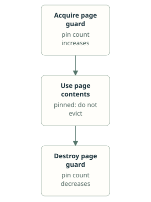

# Pages, guards, and caching

Own page buffers and define pin/dirty/eviction contracts.

## A page is a bounded byte buffer with an identity

Before this chapter: [Validate a complete candidate before replacing live state](../binary-codecs/README.md)

A page is a fixed-size unit of storage. A cache temporarily keeps pages for reuse; eviction removes one to make room. A pin marks a page as in use, and dirty means its cached contents have changed and need the model’s write-back handling.

A page manager separates logical page IDs from the buffers currently holding their bytes. A page buffer has an explicit fixed capacity and an ownership contract. The teaching cache uses sixteen-byte pages and two frames to make eviction easy to observe.

The disk member is an in-memory backing model, not an actual durable device.

```cpp
#include <array>
#include <iostream>
#include <map>
#include <optional>
#include <stdexcept>
#include <utility>

struct Cache {
    struct Frame {
        bool used = false, dirty = false;
        unsigned id = 0, pins = 0;
        std::size_t touched = 0;
        std::array<unsigned char, 16> bytes{};
    };
    std::array<Frame, 2> frames{};
    std::map<unsigned, std::array<unsigned char, 16>> disk;
    std::size_t clock = 0, hits = 0, misses = 0;
    struct Guard {
        Cache *cache;
        std::size_t slot;
        Guard(Cache &owner, std::size_t at) : cache(&owner), slot(at) {
        }
        Guard(const Guard &) = delete;
        Guard &operator=(const Guard &) = delete;
        Guard(Guard &&other) noexcept
            : cache(std::exchange(other.cache, nullptr)), slot(other.slot) {
        }
        ~Guard() {
            if (cache)
                --cache->frames[slot].pins;
        }
        unsigned read(std::size_t at) const {
            return cache->frames[slot].bytes.at(at);
        }
        void write(std::size_t at, unsigned char value) {
            auto &frame = cache->frames[slot];
            frame.bytes.at(at) = value;
            frame.dirty = true;
        }
    };
    Guard pin(unsigned id) {
        for (std::size_t i = 0; i < frames.size(); ++i)
            if (frames[i].used && frames[i].id == id) {
                ++hits;
                ++frames[i].pins;
                frames[i].touched = ++clock;
                return Guard(*this, i);
            }
        std::optional<std::size_t> victim;
        for (std::size_t i = 0; i < frames.size(); ++i)
            if (!frames[i].pins && (!victim || !frames[i].used ||
                                    frames[i].touched < frames[*victim].touched))
                victim = i;
        if (!victim)
            throw std::runtime_error("all pages pinned");
        ++misses;
        auto &frame = frames[*victim];
        if (frame.used && frame.dirty)
            disk[frame.id] = frame.bytes;
        auto found = disk.find(id);
        frame = {};
        frame.used = true;
        frame.id = id;
        frame.pins = 1;
        frame.touched = ++clock;
        if (found != disk.end())
            frame.bytes = found->second;
        return Guard(*this, *victim);
    }
};

int main() {
    Cache cache;
    auto page = cache.pin(7);
    page.write(0, 42);
    std::cout << "page=7 byte=" << page.read(0)
              << " size=" << cache.frames[0].bytes.size() << "\n";
}

```

Original program output:

```text
page=7 byte=42 size=16
```

Pinning page seven returns a guard for a cache frame. The write changes its first byte and marks the frame dirty.

Pitfall: A frame position is not a permanent page ID; eviction can reuse that position for another page.

Question: Is a frame slot a stable page identity?

1. Yes
2. No
3. Only for dirty pages

Answer: 2. Frames are reusable storage; page IDs identify logical contents.

### Run the starter, then try a change

Open `native/examples/page-units.cpp` in your checkout. From the repository root, use this command in a Linux or Codespaces terminal to compile and run the current file in a fresh temporary directory.

```sh
run_dir=$(mktemp -d) && g++ -std=c++20 -Wall -Wextra -Werror native/examples/page-units.cpp -o "$run_dir/example" && (cd "$run_dir" && ./example)
```

Replace

```cpp
page.write(0, 42);
```

With

```cpp
page.write(0, 75);
```

Rerun the terminal command. Compare page=, byte= and size=. Which quantity changes when you write a different value to the same byte position?

## A scoped guard prevents eviction while a page is borrowed

Before this chapter: [Validate a complete candidate before replacing live state](../binary-codecs/README.md)

A pin count records active users of a frame. An RAII guard releases one pin at destruction, including exception unwinding. Eviction must choose only unpinned frames.

The cache must outlive every guard. This single-threaded model does not make a raw reference safe after the guard releases its pin.



An unpinned page becomes eligible for eviction; it is not necessarily evicted immediately. Dirty-page handling and host I/O errors are separate responsibilities.

Text description: Acquire page guard: pin count increases. Use page contents: pinned: do not evict. Destroy page guard: pin count decreases. Acquire page guard → Use page contents (then); Use page contents → Destroy page guard (then).

```cpp
#include <array>
#include <iostream>
#include <map>
#include <optional>
#include <stdexcept>
#include <utility>

struct Cache {
    struct Frame {
        bool used = false, dirty = false;
        unsigned id = 0, pins = 0;
        std::size_t touched = 0;
        std::array<unsigned char, 16> bytes{};
    };
    std::array<Frame, 2> frames{};
    std::map<unsigned, std::array<unsigned char, 16>> disk;
    std::size_t clock = 0, hits = 0, misses = 0;
    struct Guard {
        Cache *cache;
        std::size_t slot;
        Guard(Cache &owner, std::size_t at) : cache(&owner), slot(at) {
        }
        Guard(const Guard &) = delete;
        Guard &operator=(const Guard &) = delete;
        Guard(Guard &&other) noexcept
            : cache(std::exchange(other.cache, nullptr)), slot(other.slot) {
        }
        ~Guard() {
            if (cache)
                --cache->frames[slot].pins;
        }
        unsigned read(std::size_t at) const {
            return cache->frames[slot].bytes.at(at);
        }
        void write(std::size_t at, unsigned char value) {
            auto &frame = cache->frames[slot];
            frame.bytes.at(at) = value;
            frame.dirty = true;
        }
    };
    Guard pin(unsigned id) {
        for (std::size_t i = 0; i < frames.size(); ++i)
            if (frames[i].used && frames[i].id == id) {
                ++hits;
                ++frames[i].pins;
                frames[i].touched = ++clock;
                return Guard(*this, i);
            }
        std::optional<std::size_t> victim;
        for (std::size_t i = 0; i < frames.size(); ++i)
            if (!frames[i].pins && (!victim || !frames[i].used ||
                                    frames[i].touched < frames[*victim].touched))
                victim = i;
        if (!victim)
            throw std::runtime_error("all pages pinned");
        ++misses;
        auto &frame = frames[*victim];
        if (frame.used && frame.dirty)
            disk[frame.id] = frame.bytes;
        auto found = disk.find(id);
        frame = {};
        frame.used = true;
        frame.id = id;
        frame.pins = 1;
        frame.touched = ++clock;
        if (found != disk.end())
            frame.bytes = found->second;
        return Guard(*this, *victim);
    }
};

int main() {
    Cache cache;
    {
        auto first = cache.pin(1);
        auto second = cache.pin(2);
        try {
            auto third = cache.pin(3);
            std::cout << third.read(0);
        } catch (const std::exception &error) {
            std::cout << error.what() << "\n";
        }
    }
    auto available = cache.pin(3);
    std::cout << "after release=" << available.read(0) << "\n";
}

```

Original program output:

```text
all pages pinned
after release=0
```

Both frames are unavailable while guards live. Leaving the scope releases the pins and allows a new page to load.

Pitfall: Returning a borrowed page pointer after destroying its guard defeats the eviction protection.

Question: What makes the third pin fail initially?

1. Page three has an invalid ID
2. Every frame has an active pin
3. Dirty pages can never be evicted

Answer: 2. Active users retain the two frames.

### Run the starter, then try a change

Open `native/examples/pin-guards.cpp` in your checkout. From the repository root, use this command in a Linux or Codespaces terminal to compile and run the current file in a fresh temporary directory.

```sh
run_dir=$(mktemp -d) && g++ -std=c++20 -Wall -Wextra -Werror native/examples/pin-guards.cpp -o "$run_dir/example" && (cd "$run_dir" && ./example)
```

Replace

```cpp
auto third = cache.pin(3);
```

With

```cpp
auto third = cache.pin(1);
```

Rerun the terminal command. Compare all pages pinned and after release=. Does another guard for a resident page require a new frame?

## Flush a dirty victim before reusing its frame

Before this chapter: [Validate a complete candidate before replacing live state](../binary-codecs/README.md)

A dirty frame differs from its backing representation. Before reusing that frame, the cache must publish its changed bytes to the backing store or explicitly reject eviction. Otherwise reloading the page loses writes.

This model uses a map assignment as publication. Actual storage needs checked writes and a separate durability protocol.

```cpp
#include <array>
#include <iostream>
#include <map>
#include <optional>
#include <stdexcept>
#include <utility>

struct Cache {
    struct Frame {
        bool used = false, dirty = false;
        unsigned id = 0, pins = 0;
        std::size_t touched = 0;
        std::array<unsigned char, 16> bytes{};
    };
    std::array<Frame, 2> frames{};
    std::map<unsigned, std::array<unsigned char, 16>> disk;
    std::size_t clock = 0, hits = 0, misses = 0;
    struct Guard {
        Cache *cache;
        std::size_t slot;
        Guard(Cache &owner, std::size_t at) : cache(&owner), slot(at) {
        }
        Guard(const Guard &) = delete;
        Guard &operator=(const Guard &) = delete;
        Guard(Guard &&other) noexcept
            : cache(std::exchange(other.cache, nullptr)), slot(other.slot) {
        }
        ~Guard() {
            if (cache)
                --cache->frames[slot].pins;
        }
        unsigned read(std::size_t at) const {
            return cache->frames[slot].bytes.at(at);
        }
        void write(std::size_t at, unsigned char value) {
            auto &frame = cache->frames[slot];
            frame.bytes.at(at) = value;
            frame.dirty = true;
        }
    };
    Guard pin(unsigned id) {
        for (std::size_t i = 0; i < frames.size(); ++i)
            if (frames[i].used && frames[i].id == id) {
                ++hits;
                ++frames[i].pins;
                frames[i].touched = ++clock;
                return Guard(*this, i);
            }
        std::optional<std::size_t> victim;
        for (std::size_t i = 0; i < frames.size(); ++i)
            if (!frames[i].pins && (!victim || !frames[i].used ||
                                    frames[i].touched < frames[*victim].touched))
                victim = i;
        if (!victim)
            throw std::runtime_error("all pages pinned");
        ++misses;
        auto &frame = frames[*victim];
        if (frame.used && frame.dirty)
            disk[frame.id] = frame.bytes;
        auto found = disk.find(id);
        frame = {};
        frame.used = true;
        frame.id = id;
        frame.pins = 1;
        frame.touched = ++clock;
        if (found != disk.end())
            frame.bytes = found->second;
        return Guard(*this, *victim);
    }
};

int main() {
    Cache cache;
    {
        auto page = cache.pin(1);
        page.write(0, 99);
    }
    {
        auto page = cache.pin(2);
    }
    {
        auto page = cache.pin(3);
    }
    auto reopened = cache.pin(1);
    std::cout << "reloaded=" << reopened.read(0) << "\n";
}

```

Original program output:

```text
reloaded=99
```

Loading a third page evicts the older unpinned dirty page. Reloading it restores byte 99 from the backing model.

Pitfall: A dirty flag is not proof that bytes have reached a durable medium.

Question: What must happen before dirty-frame reuse?

1. Its pin count becomes negative
2. Its page ID is discarded without writing
3. Its changed data is retained by the backing layer

Answer: 3. Eviction must preserve the page’s logical contents.

### Run the starter, then try a change

Open `native/examples/dirty-eviction.cpp` in your checkout. From the repository root, use this command in a Linux or Codespaces terminal to compile and run the current file in a fresh temporary directory.

```sh
run_dir=$(mktemp -d) && g++ -std=c++20 -Wall -Wextra -Werror native/examples/dirty-eviction.cpp -o "$run_dir/example" && (cd "$run_dir" && ./example)
```

Replace

```cpp
page.write(0, 99)
```

With

```cpp
page.write(0, 50)
```

Rerun the terminal command. Compare reloaded=. Which value survives eviction of the original frame?

## Separate cache hits from backing loads

Before this chapter: [Validate a complete candidate before replacing live state](../binary-codecs/README.md)

New terms and notation:

Flushing passes pending changes from one buffered layer to the next, such as writing dirty cached bytes through a file interface. It does not by itself prove that those bytes reached durable physical storage; each host interface must specify what completion guarantees.

A cache hit reuses a frame already holding the requested logical page. A miss requires selecting a frame and loading backing bytes. These counts help explain a workload without conflating them with elapsed time.

Replacement state should update on successful access, and pinned frames remain excluded regardless of recency.

```cpp
#include <array>
#include <iostream>
#include <map>
#include <optional>
#include <stdexcept>
#include <utility>

struct Cache {
    struct Frame {
        bool used = false, dirty = false;
        unsigned id = 0, pins = 0;
        std::size_t touched = 0;
        std::array<unsigned char, 16> bytes{};
    };
    std::array<Frame, 2> frames{};
    std::map<unsigned, std::array<unsigned char, 16>> disk;
    std::size_t clock = 0, hits = 0, misses = 0;
    struct Guard {
        Cache *cache;
        std::size_t slot;
        Guard(Cache &owner, std::size_t at) : cache(&owner), slot(at) {
        }
        Guard(const Guard &) = delete;
        Guard &operator=(const Guard &) = delete;
        Guard(Guard &&other) noexcept
            : cache(std::exchange(other.cache, nullptr)), slot(other.slot) {
        }
        ~Guard() {
            if (cache)
                --cache->frames[slot].pins;
        }
        unsigned read(std::size_t at) const {
            return cache->frames[slot].bytes.at(at);
        }
        void write(std::size_t at, unsigned char value) {
            auto &frame = cache->frames[slot];
            frame.bytes.at(at) = value;
            frame.dirty = true;
        }
    };
    Guard pin(unsigned id) {
        for (std::size_t i = 0; i < frames.size(); ++i)
            if (frames[i].used && frames[i].id == id) {
                ++hits;
                ++frames[i].pins;
                frames[i].touched = ++clock;
                return Guard(*this, i);
            }
        std::optional<std::size_t> victim;
        for (std::size_t i = 0; i < frames.size(); ++i)
            if (!frames[i].pins && (!victim || !frames[i].used ||
                                    frames[i].touched < frames[*victim].touched))
                victim = i;
        if (!victim)
            throw std::runtime_error("all pages pinned");
        ++misses;
        auto &frame = frames[*victim];
        if (frame.used && frame.dirty)
            disk[frame.id] = frame.bytes;
        auto found = disk.find(id);
        frame = {};
        frame.used = true;
        frame.id = id;
        frame.pins = 1;
        frame.touched = ++clock;
        if (found != disk.end())
            frame.bytes = found->second;
        return Guard(*this, *victim);
    }
};

int main() {
    Cache cache;
    {
        auto page = cache.pin(1);
    }
    {
        auto page = cache.pin(1);
    }
    {
        auto page = cache.pin(2);
    }
    std::cout << "hits=" << cache.hits << " misses=" << cache.misses << "\n";
}

```

Original program output:

```text
hits=1 misses=2
```

The second request for page one is a hit. The first requests for pages one and two are misses.

Pitfall: A high hit rate does not establish correctness of dirty flushing or pin lifetime management.

Question: Which request is a cache hit?

1. Every request that returns a guard
2. The second request for page one
3. Only a dirty-page request

Answer: 2. The page is already resident under the requested identity.

### Run the starter, then try a change

Open `native/examples/cache-hits.cpp` in your checkout. From the repository root, use this command in a Linux or Codespaces terminal to compile and run the current file in a fresh temporary directory.

```sh
run_dir=$(mktemp -d) && g++ -std=c++20 -Wall -Wextra -Werror native/examples/cache-hits.cpp -o "$run_dir/example" && (cd "$run_dir" && ./example)
```

Replace

```cpp
auto page = cache.pin(2);
```

With

```cpp
auto page = cache.pin(1);
```

Rerun the terminal command. Compare hits= and misses=. Which access first loads page 1, and which subsequent accesses can reuse it?

## Moving a guard transfers its release responsibility

Before this chapter: [Validate a complete candidate before replacing live state](../binary-codecs/README.md)

A page guard is move-only because copying it without incrementing the pin count would cause two destructors to release one pin. A move transfers the release responsibility and leaves the source inactive.

This is ownership of a protocol obligation rather than ownership of the frame allocation itself. The cache continues owning every frame.

```cpp
#include <array>
#include <iostream>
#include <map>
#include <optional>
#include <stdexcept>
#include <utility>

struct Cache {
    struct Frame {
        bool used = false, dirty = false;
        unsigned id = 0, pins = 0;
        std::size_t touched = 0;
        std::array<unsigned char, 16> bytes{};
    };
    std::array<Frame, 2> frames{};
    std::map<unsigned, std::array<unsigned char, 16>> disk;
    std::size_t clock = 0, hits = 0, misses = 0;
    struct Guard {
        Cache *cache;
        std::size_t slot;
        Guard(Cache &owner, std::size_t at) : cache(&owner), slot(at) {
        }
        Guard(const Guard &) = delete;
        Guard &operator=(const Guard &) = delete;
        Guard(Guard &&other) noexcept
            : cache(std::exchange(other.cache, nullptr)), slot(other.slot) {
        }
        ~Guard() {
            if (cache)
                --cache->frames[slot].pins;
        }
        unsigned read(std::size_t at) const {
            return cache->frames[slot].bytes.at(at);
        }
        void write(std::size_t at, unsigned char value) {
            auto &frame = cache->frames[slot];
            frame.bytes.at(at) = value;
            frame.dirty = true;
        }
    };
    Guard pin(unsigned id) {
        for (std::size_t i = 0; i < frames.size(); ++i)
            if (frames[i].used && frames[i].id == id) {
                ++hits;
                ++frames[i].pins;
                frames[i].touched = ++clock;
                return Guard(*this, i);
            }
        std::optional<std::size_t> victim;
        for (std::size_t i = 0; i < frames.size(); ++i)
            if (!frames[i].pins && (!victim || !frames[i].used ||
                                    frames[i].touched < frames[*victim].touched))
                victim = i;
        if (!victim)
            throw std::runtime_error("all pages pinned");
        ++misses;
        auto &frame = frames[*victim];
        if (frame.used && frame.dirty)
            disk[frame.id] = frame.bytes;
        auto found = disk.find(id);
        frame = {};
        frame.used = true;
        frame.id = id;
        frame.pins = 1;
        frame.touched = ++clock;
        if (found != disk.end())
            frame.bytes = found->second;
        return Guard(*this, *victim);
    }
};

int main() {
    Cache cache;
    {
        auto first = cache.pin(1);
        auto moved = std::move(first);
        moved.write(1, 7);
        std::cout << "pins=" << (cache.frames[0].pins + cache.frames[1].pins)
                  << " value=" << moved.read(1) << "\n";
    }
    std::cout << "released=" << (cache.frames[0].pins + cache.frames[1].pins) << "\n";
}

```

Original program output:

```text
pins=1 value=7
released=0
```

Moving the guard keeps one pin. Only the active moved guard releases it at scope exit.

Pitfall: Default-copying a protocol guard can double-release even when no memory is directly deleted.

Question: What obligation moves with the guard?

1. Deleting the entire cache
2. Writing every page to disk
3. Releasing exactly one pin

Answer: 3. The guard owns one release action.

### Run the starter, then try a change

Open `native/examples/guard-moves.cpp` in your checkout. From the repository root, use this command in a Linux or Codespaces terminal to compile and run the current file in a fresh temporary directory.

```sh
run_dir=$(mktemp -d) && g++ -std=c++20 -Wall -Wextra -Werror native/examples/guard-moves.cpp -o "$run_dir/example" && (cd "$run_dir" && ./example)
```

Replace

```cpp
moved.write(1, 7)
```

With

```cpp
moved.write(1, 9)
```

Rerun the terminal command. Compare pins=, value= and released=. Does the value written by the moved guard change how many pins it owns?

## Chapter project

Build a bounded page cache with scoped pin guards.
