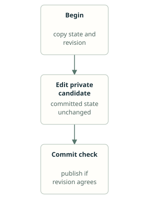

# Transaction state and commit

Keep tentative writes separate from committed state.

## Begin with a private candidate state

Before this chapter: [Check mixed updates against independent membership and structure](../bplus-tree/README.md)

New terms and notation:

A revision is a version number used to identify a particular state. Comparing the revision read earlier with the current one can detect that someone has changed the state in the meantime; the comparison and publication must obey the model’s synchronization rules.

Committed state is the version currently published as accepted. Tentative state contains proposed changes not yet published. These lessons edit a private candidate, then either commit it after validation or discard it on rollback.

A transaction separates tentative writes from committed state. This teaching store copies a bounded map at begin so transaction-local changes cannot leak through shared mutable rows.

It is a serialized in-memory state model, not a concurrent implementation or a durable transaction engine. Later lessons add conflict and publication contracts.

```cpp
#include <iostream>
#include <map>
#include <stdexcept>
#include <utility>

struct Transaction {
    unsigned base;
    std::map<int, int> rows;
    bool active = true;
};
struct Store {
    unsigned revision = 0;
    std::map<int, int> rows{{1, 10}, {2, 20}};
    Transaction begin() const {
        return {revision, rows, true};
    }
    bool commit(Transaction &transaction) {
        if (!transaction.active || transaction.base != revision)
            return false;
        auto candidate = transaction.rows;
        rows.swap(candidate);
        ++revision;
        transaction.active = false;
        return true;
    }
};
void rollback(Transaction &transaction) {
    transaction.rows.clear();
    transaction.active = false;
}

int main() {
    Store store;
    auto transaction = store.begin();
    transaction.rows.at(1) = 99;
    std::cout << "private=" << transaction.rows.at(1)
              << " committed=" << store.rows.at(1) << "\n";
}

```

Original program output:

```text
private=99 committed=10
```

The private map contains the new value while the committed map still contains the old value.

Pitfall: Copying only pointers to mutable rows would not isolate tentative writes.

Question: Why are committed rows unchanged?

1. The transaction owns a separate candidate map
2. The output stream rolls back writes
3. All map copies share immutable storage

Answer: 1. Owning value semantics separate the two mutable states.

### Run the starter, then try a change

Open `native/examples/transaction-begin.cpp` in your checkout. From the repository root, use this command in a Linux or Codespaces terminal to compile and run the current file in a fresh temporary directory.

```sh
run_dir=$(mktemp -d) && g++ -std=c++20 -Wall -Wextra -Werror native/examples/transaction-begin.cpp -o "$run_dir/example" && (cd "$run_dir" && ./example)
```

Replace

```cpp
transaction.rows.at(1) = 99
```

With

```cpp
transaction.rows.at(1) = 42
```

Rerun the terminal command. Compare private= and committed=. Does changing the private table immediately change another view of committed state?

## A transaction needs a coherent read view

Before this chapter: [Check mixed updates against independent membership and structure](../bplus-tree/README.md)

A transaction usually reads its own writes even when other observers still see committed state. Its read interface must specify whether it consults a private candidate, an overlay, or a versioned snapshot.

This copy-based model reads directly from the candidate map. The representation is simple but incurs whole-table copying at begin.

```cpp
#include <iostream>
#include <map>
#include <stdexcept>
#include <utility>

struct Transaction {
    unsigned base;
    std::map<int, int> rows;
    bool active = true;
};
struct Store {
    unsigned revision = 0;
    std::map<int, int> rows{{1, 10}, {2, 20}};
    Transaction begin() const {
        return {revision, rows, true};
    }
    bool commit(Transaction &transaction) {
        if (!transaction.active || transaction.base != revision)
            return false;
        auto candidate = transaction.rows;
        rows.swap(candidate);
        ++revision;
        transaction.active = false;
        return true;
    }
};
void rollback(Transaction &transaction) {
    transaction.rows.clear();
    transaction.active = false;
}

int main() {
    Store store;
    auto transaction = store.begin();
    transaction.rows[3] = 30;
    std::cout << "own=" << transaction.rows.contains(3)
              << " external=" << store.rows.contains(3) << "\n";
}

```

Original program output:

```text
own=1 external=0
```

The newly inserted key is visible inside the transaction and absent from the committed view.

Pitfall: Reading from committed state after writing a private overlay can hide a transaction’s own changes.

Question: Which state supplies this transaction’s reads?

1. Its candidate map
2. Only the original committed map
3. Whichever map has fewer rows

Answer: 1. The read view and tentative writes share one private state.

### Run the starter, then try a change

Open `native/examples/read-own-writes.cpp` in your checkout. From the repository root, use this command in a Linux or Codespaces terminal to compile and run the current file in a fresh temporary directory.

```sh
run_dir=$(mktemp -d) && g++ -std=c++20 -Wall -Wextra -Werror native/examples/read-own-writes.cpp -o "$run_dir/example" && (cd "$run_dir" && ./example)
```

Replace

```cpp
transaction.rows[3] = 30;
```

With

```cpp
transaction.rows.erase(3);
```

Rerun the terminal command. Compare own= and external=. What does each report about a key the transaction did not insert?

## Publish a complete candidate at commit

Before this chapter: [Check mixed updates against independent membership and structure](../bplus-tree/README.md)

New terms and notation:

An atomic operation is an indivisible access to an atomic object. It prevents certain torn or conflicting accesses to that object, but does not automatically protect surrounding ordinary data or a multi-step invariant.

Commit validates the transaction’s base revision, prepares the candidate copy, and publishes it with a nonthrowing map swap. All rows become visible through one serialized state transition.

This atomicity is a model of observable commit boundaries. It does not make unsynchronized threads safe to access the map concurrently.



A stale revision rejects the commit rather than overwriting a newer state. Rollback discards private changes. This model does not claim a complete multi-client durable transaction engine.

Text description: Begin: copy state and revision. Edit private candidate: committed state unchanged. Commit check: publish if revision agrees. Begin → Edit private candidate (then); Edit private candidate → Commit check (then).

```cpp
#include <iostream>
#include <map>
#include <stdexcept>
#include <utility>

struct Transaction {
    unsigned base;
    std::map<int, int> rows;
    bool active = true;
};
struct Store {
    unsigned revision = 0;
    std::map<int, int> rows{{1, 10}, {2, 20}};
    Transaction begin() const {
        return {revision, rows, true};
    }
    bool commit(Transaction &transaction) {
        if (!transaction.active || transaction.base != revision)
            return false;
        auto candidate = transaction.rows;
        rows.swap(candidate);
        ++revision;
        transaction.active = false;
        return true;
    }
};
void rollback(Transaction &transaction) {
    transaction.rows.clear();
    transaction.active = false;
}

int main() {
    Store store;
    auto transaction = store.begin();
    transaction.rows.at(1) = 99;
    std::cout << "commit=" << store.commit(transaction) << " value=" << store.rows.at(1)
              << " revision=" << store.revision << "\n";
}

```

Original program output:

```text
commit=1 value=99 revision=1
```

A successful commit advances the revision and makes the transaction inactive.

Pitfall: Updating committed rows one by one can expose a partially committed batch to observers.

Question: What publishes the prepared state?

1. The final map swap
2. Each private assignment
3. Printing a success message

Answer: 1. Preparation and publication are separate operations.

### Run the starter, then try a change

Open `native/examples/transaction-commit.cpp` in your checkout. From the repository root, use this command in a Linux or Codespaces terminal to compile and run the current file in a fresh temporary directory.

```sh
run_dir=$(mktemp -d) && g++ -std=c++20 -Wall -Wextra -Werror native/examples/transaction-commit.cpp -o "$run_dir/example" && (cd "$run_dir" && ./example)
```

Replace

```cpp
transaction.rows.at(1) = 99
```

With

```cpp
transaction.rows.at(1) = 42
```

Rerun the terminal command. Compare commit=, value= and revision=. Which field records the published value and which records the successful publication?

## Rollback discards tentative ownership

Before this chapter: [Check mixed updates against independent membership and structure](../bplus-tree/README.md)

Rollback ends a transaction without publishing its candidate. In this model, clearing the private map and marking it inactive releases tentative state while leaving the committed map alone.

An already rolled-back transaction must not be committed later. Transaction lifecycle state is part of the API, not a comment remembered only by callers.

```cpp
#include <iostream>
#include <map>
#include <stdexcept>
#include <utility>

struct Transaction {
    unsigned base;
    std::map<int, int> rows;
    bool active = true;
};
struct Store {
    unsigned revision = 0;
    std::map<int, int> rows{{1, 10}, {2, 20}};
    Transaction begin() const {
        return {revision, rows, true};
    }
    bool commit(Transaction &transaction) {
        if (!transaction.active || transaction.base != revision)
            return false;
        auto candidate = transaction.rows;
        rows.swap(candidate);
        ++revision;
        transaction.active = false;
        return true;
    }
};
void rollback(Transaction &transaction) {
    transaction.rows.clear();
    transaction.active = false;
}

int main() {
    Store store;
    auto transaction = store.begin();
    transaction.rows.at(1) = 99;
    rollback(transaction);
    std::cout << "value=" << store.rows.at(1) << " inactive=" << !transaction.active
              << " commit=" << store.commit(transaction) << "\n";
}

```

Original program output:

```text
value=10 inactive=1 commit=0
```

The original committed value remains ten, and the inactive candidate is rejected by commit.

Pitfall: A rollback that changes only a printed status but leaves the transaction active permits accidental later publication.

Question: Can this rolled-back transaction commit?

1. Yes, if its map is empty
2. No
3. Only once

Answer: 2. The active-state check rejects ended transactions.

### Run the starter, then try a change

Open `native/examples/transaction-rollback.cpp` in your checkout. From the repository root, use this command in a Linux or Codespaces terminal to compile and run the current file in a fresh temporary directory.

```sh
run_dir=$(mktemp -d) && g++ -std=c++20 -Wall -Wextra -Werror native/examples/transaction-rollback.cpp -o "$run_dir/example" && (cd "$run_dir" && ./example)
```

Replace

```cpp
transaction.rows.at(1) = 99
```

With

```cpp
transaction.rows.at(1) = 42
```

Rerun the terminal command. Compare value=, inactive= and commit=. Does rollback leave any of the private value in the store?

## Reject a commit based on an old revision

Before this chapter: [Check mixed updates against independent membership and structure](../bplus-tree/README.md)

New terms and notation:

A mutex is a lock used to let only one participating thread enter a protected region at a time. Every access covered by that protection rule must follow it; locking one access does not protect unrelated uncoordinated accesses.

Two candidates can begin from the same committed revision. Publishing one invalidates the other candidate’s base revision. A compare-before-publish check prevents the later stale candidate from silently overwriting the newer state.

This coarse whole-store validation rejects more cases than a fine-grained conflict detector, but its failure contract is easy to observe.

```cpp
#include <iostream>
#include <map>
#include <stdexcept>
#include <utility>

struct Transaction {
    unsigned base;
    std::map<int, int> rows;
    bool active = true;
};
struct Store {
    unsigned revision = 0;
    std::map<int, int> rows{{1, 10}, {2, 20}};
    Transaction begin() const {
        return {revision, rows, true};
    }
    bool commit(Transaction &transaction) {
        if (!transaction.active || transaction.base != revision)
            return false;
        auto candidate = transaction.rows;
        rows.swap(candidate);
        ++revision;
        transaction.active = false;
        return true;
    }
};
void rollback(Transaction &transaction) {
    transaction.rows.clear();
    transaction.active = false;
}

int main() {
    Store store;
    auto first = store.begin(), stale = store.begin();
    first.rows.at(1) = 50;
    store.commit(first);
    stale.rows.at(2) = 80;
    std::cout << "stale=" << !store.commit(stale) << " retained=" << store.rows.at(1)
              << "," << store.rows.at(2) << "\n";
}

```

Original program output:

```text
stale=1 retained=50,20
```

The stale candidate is rejected in full. The newer value fifty survives and the stale update to key two is not published.

Pitfall: Checking a revision before an unlocked write does not prevent races in a real concurrent implementation; validation and publication need synchronization together.

Question: What must be protected together in a concurrent implementation?

1. Only output formatting
2. Revision validation and state publication
3. Only candidate construction

Answer: 2. The check must remain valid through publication.

### Run the starter, then try a change

Open `native/examples/stale-commit.cpp` in your checkout. From the repository root, use this command in a Linux or Codespaces terminal to compile and run the current file in a fresh temporary directory.

```sh
run_dir=$(mktemp -d) && g++ -std=c++20 -Wall -Wextra -Werror native/examples/stale-commit.cpp -o "$run_dir/example" && (cd "$run_dir" && ./example)
```

Replace

```cpp
stale.rows.at(2) = 80
```

With

```cpp
stale.rows.at(2) = 81
```

Rerun the terminal command. Compare stale= and retained=. Does changing the contents of a stale candidate make its revision current?

## Commit related fields as one logical unit

Before this chapter: [Check mixed updates against independent membership and structure](../bplus-tree/README.md)

A transaction can preserve a compound invariant across several tentative updates. A transfer between two balances should publish both changes or neither, provided validation and arithmetic checks have succeeded.

The example uses small nonnegative values and a serialized commit. A real transfer API also needs insufficient-funds and overflow rejection before candidate mutation.

```cpp
#include <iostream>
#include <map>
#include <stdexcept>
#include <utility>

struct Transaction {
    unsigned base;
    std::map<int, int> rows;
    bool active = true;
};
struct Store {
    unsigned revision = 0;
    std::map<int, int> rows{{1, 10}, {2, 20}};
    Transaction begin() const {
        return {revision, rows, true};
    }
    bool commit(Transaction &transaction) {
        if (!transaction.active || transaction.base != revision)
            return false;
        auto candidate = transaction.rows;
        rows.swap(candidate);
        ++revision;
        transaction.active = false;
        return true;
    }
};
void rollback(Transaction &transaction) {
    transaction.rows.clear();
    transaction.active = false;
}

int main() {
    Store store;
    auto transaction = store.begin();
    transaction.rows.at(1) -= 3;
    transaction.rows.at(2) += 3;
    store.commit(transaction);
    std::cout << store.rows.at(1) << "+" << store.rows.at(2) << "="
              << store.rows.at(1) + store.rows.at(2) << "\n";
}

```

Original program output:

```text
7+23=30
```

The total is conserved while the individual balances change together at commit.

Pitfall: Atomic counters for individual balances do not automatically make the two-field transfer invariant atomic.

Question: Which invariant should every committed transfer preserve?

1. Each individual balance is unchanged
2. The combined total, absent fees or external changes
3. The transaction map stays empty

Answer: 2. The operation changes two fields while preserving their sum.

### Run the starter, then try a change

Open `native/examples/batch-invariant.cpp` in your checkout. From the repository root, use this command in a Linux or Codespaces terminal to compile and run the current file in a fresh temporary directory.

```sh
run_dir=$(mktemp -d) && g++ -std=c++20 -Wall -Wextra -Werror native/examples/batch-invariant.cpp -o "$run_dir/example" && (cd "$run_dir" && ./example)
```

Replace

```cpp
transaction.rows.at(1) -= 3;
    transaction.rows.at(2) += 3;
```

With

```cpp
transaction.rows.at(1) -= 4;
    transaction.rows.at(2) += 4;
```

Rerun the terminal command. Compare the two balances and total. Which quantity does this paired transfer preserve?

## Fallible preparation must precede publication

Before this chapter: [Check mixed updates against independent membership and structure](../bplus-tree/README.md)

A commit can fail while validating or allocating a candidate. Arrange those operations before the nonthrowing publication step so failure leaves committed state unchanged.

This fixture injects a validation exception explicitly. It illustrates the commit ordering rather than relying on an unpredictable allocation failure.

```cpp
#include <iostream>
#include <map>
#include <stdexcept>
#include <utility>

struct Transaction {
    unsigned base;
    std::map<int, int> rows;
    bool active = true;
};
struct Store {
    unsigned revision = 0;
    std::map<int, int> rows{{1, 10}, {2, 20}};
    Transaction begin() const {
        return {revision, rows, true};
    }
    bool commit(Transaction &transaction) {
        if (!transaction.active || transaction.base != revision)
            return false;
        auto candidate = transaction.rows;
        rows.swap(candidate);
        ++revision;
        transaction.active = false;
        return true;
    }
};
void rollback(Transaction &transaction) {
    transaction.rows.clear();
    transaction.active = false;
}

int main() {
    Store store;
    auto transaction = store.begin();
    transaction.rows.at(1) = -1;
    try {
        if (transaction.rows.at(1) < 0)
            throw std::runtime_error("negative balance");
        store.commit(transaction);
    } catch (const std::exception &error) {
        std::cout << error.what() << "\n";
    }
    std::cout << "committed=" << store.rows.at(1) << " revision=" << store.revision
              << "\n";
}

```

Original program output:

```text
negative balance
committed=10 revision=0
```

Validation fails before commit, so neither the committed value nor revision changes.

Pitfall: Catching an exception after publishing a partially prepared state cannot establish the strong guarantee retroactively.

Question: Where must fallible validation occur?

1. After increasing the revision
2. Only in the caller’s log formatter
3. Before publication

Answer: 3. The old committed state remains the fallback until preparation succeeds.

### Run the starter, then try a change

Open `native/examples/commit-preparation-failure.cpp` in your checkout. From the repository root, use this command in a Linux or Codespaces terminal to compile and run the current file in a fresh temporary directory.

```sh
run_dir=$(mktemp -d) && g++ -std=c++20 -Wall -Wextra -Werror native/examples/commit-preparation-failure.cpp -o "$run_dir/example" && (cd "$run_dir" && ./example)
```

Replace

```cpp
transaction.rows.at(1) = -1
```

With

```cpp
transaction.rows.at(1) = 11
```

Rerun the terminal command. Compare the message, committed= and revision=. When does the store publish the prepared balance?

## Make begin, commit, and abort states explicit

Before this chapter: [Check mixed updates against independent membership and structure](../bplus-tree/README.md)

A transaction lifecycle defines which operations are legal before and after completion. Reusing a completed candidate can otherwise replay old work against a new revision.

This model permits one successful commit per transaction. A failed stale commit remains active so the caller can inspect or discard it, but cannot succeed without a new begin under this API.

```cpp
#include <iostream>
#include <map>
#include <stdexcept>
#include <utility>

struct Transaction {
    unsigned base;
    std::map<int, int> rows;
    bool active = true;
};
struct Store {
    unsigned revision = 0;
    std::map<int, int> rows{{1, 10}, {2, 20}};
    Transaction begin() const {
        return {revision, rows, true};
    }
    bool commit(Transaction &transaction) {
        if (!transaction.active || transaction.base != revision)
            return false;
        auto candidate = transaction.rows;
        rows.swap(candidate);
        ++revision;
        transaction.active = false;
        return true;
    }
};
void rollback(Transaction &transaction) {
    transaction.rows.clear();
    transaction.active = false;
}

int main() {
    Store store;
    auto transaction = store.begin();
    bool first = store.commit(transaction), second = store.commit(transaction);
    std::cout << "first=" << first << " second=" << second
              << " revision=" << store.revision << "\n";
}

```

Original program output:

```text
first=1 second=0 revision=1
```

The first commit ends the transaction. The second fails without advancing the store revision again.

Pitfall: An inactive flag that is never checked does not enforce a lifecycle contract.

Question: How many successful commits can this candidate perform?

1. Unlimited
2. One
3. Two if no rows changed

Answer: 2. Successful commit marks it inactive.

### Run the starter, then try a change

Open `native/examples/transaction-lifecycle.cpp` in your checkout. From the repository root, use this command in a Linux or Codespaces terminal to compile and run the current file in a fresh temporary directory.

```sh
run_dir=$(mktemp -d) && g++ -std=c++20 -Wall -Wextra -Werror native/examples/transaction-lifecycle.cpp -o "$run_dir/example" && (cd "$run_dir" && ./example)
```

Replace

```cpp
bool first = store.commit(transaction), second = store.commit(transaction);
```

With

```cpp
rollback(transaction); bool first = store.commit(transaction), second = store.commit(transaction);
```

Rerun the terminal command. Compare the two commit results and revision=. What does each attempt report after the candidate has already ended?

## Chapter project

Add explicit begin/commit/rollback and stale-commit rejection.
